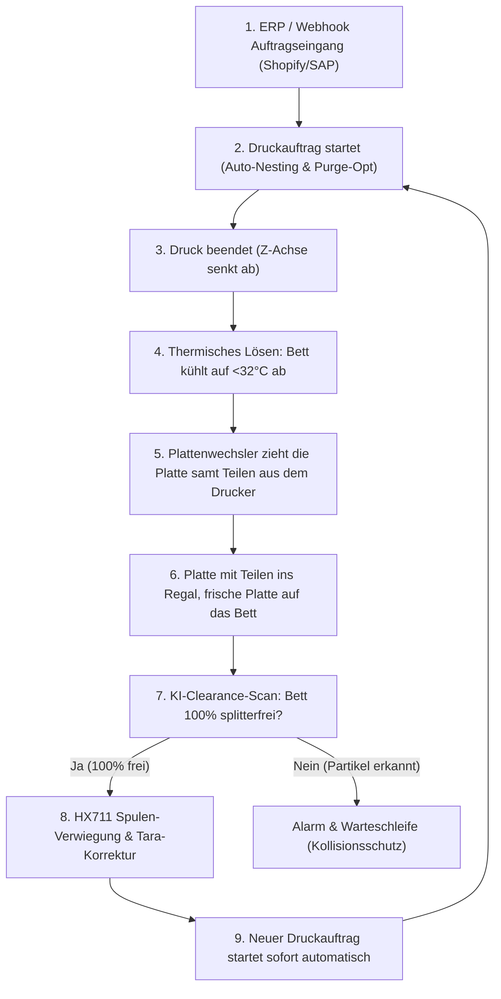

# PrintLab 3D-Druckteile & Hardware-Montageanleitung
## Vollautonomes Farm-System (Phasen 19–25)

> [!IMPORTANT]
> **Vollständige Fertigungs- & Hardware-Dokumentation**  
> Alle 6 funktionalen CAD-Modelle wurden als standardisierte, wasserdichte binäre STL-Dateien generiert und liegen einsatzbereit im Repository unter [`werkzeuge/automation_hardware/models_stl/`](file:///C:/Users/lukas/OneDrive/Desktop/Bambuddy-Fork/werkzeuge/automation_hardware/models_stl).  
> Ergänzend steht das interaktive 3D-Simulations-Cockpit unter [`printlab_automation_3d_simulation.html`](file:///C:/Users/lukas/.gemini/antigravity/brain/e9e4f911-96ba-4410-8738-c60f903ba9db/printlab_automation_3d_simulation.html) zur visuellen Zyklusprüfung bereit.

---

### Inhaltsverzeichnis
1. [Systemarchitektur der Vollautomation](#1-systemarchitektur-der-vollautomation)
2. [Katalog der 6 3D-Druckteile mit Slicer-Parametern](#2-katalog-der-6-3d-druckteile-mit-slicer-parametern)
3. [Stückliste (Bill of Materials - BOM)](#3-stückliste-bill-of-materials---bom)
4. [Elektronische Verdrahtung & Raspberry Pi GPIO-Pinout](#4-elektronische-verdrahtung--raspberry-pi-gpio-pinout)
5. [Mechanische Montage- & Justierungsanleitung](#5-mechanische-montage---justierungsanleitung)
6. [Software-Integration in PrintLab Core](#6-software-integration-in-printlab-core)
7. [Wartung & Betriebssicherheit](#7-wartung--betriebssicherheit)

---

## 1. Systemarchitektur der Vollautomation

Das System ermöglicht den **unterbrechungsfreien 24/7-Dauerbetrieb** von Bambu Lab 3D-Druckern (X1-Carbon, P1S, P1P, A1) ohne jeglichen manuellen Eingriff:



> [!NOTE]
> Die Teile bleiben auf der Platte und wandern mit ihr ins Plattenregal, sie werden dort von Hand entnommen. Abschubkeil und
> Rutsche mit Schale sind aus dem Bauplan gestrichen (die Dateien bleiben liegen). Wechselzyklus, Sperren und
> Konstruktionsprüfung: `TUER_MAGAZIN_WASCHSTATION.md`, Abschnitt 4.
> Einzelteile des Shuttles, Elektrik, Antriebe, Fahrzeiten, Strom und Inbetriebnahme: dort Abschnitt 5 bis 10.

---

## 2. Katalog der 6 3D-Druckteile mit Slicer-Parametern

Alle Bauteile wurden im Hinblick auf maximale mechanische Festigkeit, thermische Beständigkeit (Chamber-Temperaturen bis 60°C) und verzugsfreie Passgenauigkeit konstruiert.

| Nr. | Bauteil-Dateiname (STL) | Abmessungen | Material | Infill | Wände | Stützstruktur |
| :--- | :--- | :--- | :--- | :--- | :--- | :--- |
| **1 (entfällt)** | [`bambu_toolhead_sweeper_blade.stl`](file:///C:/Users/lukas/OneDrive/Desktop/Bambuddy-Fork/werkzeuge/automation_hardware/models_stl/bambu_toolhead_sweeper_blade.stl) | 75 × 30 × 12 mm | **ASA / PETG** | 35% Gyroid | 4 Wände | Keine (flach) |
| **2 (entfällt)** | [`bambu_bed_ejection_chute.stl`](file:///C:/Users/lukas/OneDrive/Desktop/Bambuddy-Fork/werkzeuge/automation_hardware/models_stl/bambu_bed_ejection_chute.stl) | 130 × 50 × 22 mm | **PETG** | 20% Grid | 3 Wände | An Klemmnasen |
| **3** | [`gpio_servo_actuator_mount.stl`](file:///C:/Users/lukas/OneDrive/Desktop/Bambuddy-Fork/werkzeuge/automation_hardware/models_stl/gpio_servo_actuator_mount.stl) | 45 × 35 × 24 mm | **PETG** | 30% Gyroid | 4 Wände | Keine |
| **4** | [`hx711_loadcell_base.stl`](file:///C:/Users/lukas/OneDrive/Desktop/Bambuddy-Fork/werkzeuge/automation_hardware/models_stl/hx711_loadcell_base.stl) | 90 × 40 × 16 mm | **PETG / PLA+** | 45% Gyroid | 5 Wände | Keine |
| **5** | [`hx711_spool_cradle.stl`](file:///C:/Users/lukas/OneDrive/Desktop/Bambuddy-Fork/werkzeuge/automation_hardware/models_stl/hx711_spool_cradle.stl) | 100 × 100 × 24 mm | **PETG** | 25% Gyroid | 3 Wände | Keine |
| **6** | [`barcode_scanner_wall_dock.stl`](file:///C:/Users/lukas/OneDrive/Desktop/Bambuddy-Fork/werkzeuge/automation_hardware/models_stl/barcode_scanner_wall_dock.stl) | 70 × 75 × 75 mm | **PETG / PLA** | 20% Grid | 3 Wände | Keine |

### Detaillierte Bauteilbeschreibungen

#### 1. Toolhead Sweeper Blade (Werkzeugkopf-Schiebekeil) – entfällt, Teile bleiben auf der Platte
- **Funktion:** Wird an der Unterseite des Werkzeugkopfs montiert. Der 35°-Abschubkeil schiebt nach dem Abkühlen der Textured PEI-Platte das Bauteil durch eine koordinierte Vorwärtsbewegung der Y-Achse sanft und ruckfrei vom Bett.
- **Druckausrichtung:** Flach auf der Montageebene (Z=0).
- **Materialempfehlung:** **ASA** (alternativ hochtemperaturbeständiges PETG oder PA-CF). Gewährleistet Formstabilität auch bei geschlossener Baukammer während ABS/PC-Drucken.

#### 2. Bed Ejection Chute (Auswurfrutsche) – entfällt, Teile bleiben auf der Platte
- **Funktion:** Wird an der vorderen Rahmenkante des Druckbetts eingeklippt. Schützt die vordere Abdeckung und leitet abgeworfene Teile mit 35° Gefälle sicher in den Sammelbehälter. Seitliche Führungsstege (15 mm) verhindern ein Verkanten.
- **Druckausrichtung:** Auf der Rutschenschräge oder auf den Montageflanschen mit Baumstützen (Tree Supports).
- **Materialempfehlung:** **PETG** (hohe Zähigkeit, glatte Oberfläche für minimale Reibung).

#### 3. Servo Actuator Mount (GPIO Servomotor-Halter)
- **Funktion:** Ermöglicht die optionale Montage eines SG90 / MG90S Micro-Servos am Aluminiumprofil, falls ein aktiver Auswurfhebel statt des Toolhead-Keils genutzt werden soll.
- **Montage:** 2× M3 Schrauben durch Profil-Nutensteine, 2× M2 Schrauben für Servo-Ohren.

#### 4. HX711 Loadcell Base (Wägezellen-Unterbau)
- **Funktion:** Verwindungssteifer Standfuß für Standard 1kg–5kg Aluminium-Biegebalken-Wägezellen (Abmessungen 80 × 12.7 × 12.7 mm).
- **Montage:** 2× M4 Senkkopfschrauben zur Befestigung des starren Endes der Wägezelle. Integrierter Kabelkanal für die 4 Messleitungen (Rot, Schwarz, Weiß, Grün).

#### 5. HX711 Spool Cradle (Spulen-Wiegeteller)
- **Funktion:** Telleraufsatz mit 52 mm Zentrierbund (exakt passend für Bambu Lab Spulen sowie Standard-Spulenkerne).
- **Montage:** 2× M4 Schrauben am auskragenden, biegenden Ende der Wägezelle. Durch die Mittenzentrierung treten keine exzentrischen Torsionsfehler auf.

#### 6. Barcode Scanner Wall Dock (Handscanner-Holster)
- **Funktion:** Ergonomische Wand- oder Profilhalterung mit 25° Neigung für kabellose oder USB-Handscanner. Ermöglicht blitzschnelles Scannen von Spulen-Barcodes (Scan-to-Action) direkt beim Einlegen.

---

## 3. Stückliste (Bill of Materials - BOM)

### Mechanische Verbindungselemente & Normteile
| Menge | Komponente | Spezifikation | Verwendung |
| :--- | :--- | :--- | :--- |
| **4 Stk.** | Ruthex Gewindeeinsätze | M3 × 5.7 mm Messing | Toolhead Blade Montage |
| **4 Stk.** | Zylinderkopfschrauben | M3 × 12 mm ISO 4762 | Toolhead Blade Befestigung |
| **2 Stk.** | Zylinderkopfschrauben | M4 × 16 mm ISO 4762 | HX711 Wägezelle an Basis |
| **2 Stk.** | Senkkopfschrauben | M4 × 14 mm ISO 10642 | Spulen-Wiegeteller an Wägezelle |
| **4 Stk.** | Nutensteine & Schrauben | M4 × 8 mm für 2020-Profil | Scanner-Dock & Chute am Rahmen |
| **1 Stk.** | Moosgummi-Pad (selbstklebend) | 75 × 10 × 2 mm | Dämpfungslippe an Sweeper Blade |

### Elektronik & Sensorik
| Menge | Komponente | Modell / Spezifikation | Schnittstelle |
| :--- | :--- | :--- | :--- |
| **1 Stk.** | Wägezelle mit HX711 ADC | 5 kg Aluminium Biegebalken + HX711 24-Bit ADC | GPIO (2 Pins: DT / SCK) |
| **1 Stk.** | Micro-Servomotor (optional) | TowerPro MG90S (Metallgetriebe) | GPIO 18 (Hardware-PWM) |
| **1 Stk.** | 1D/2D Barcode-Scanner | USB HID Handscanner (z.B. Netum / Tera) | USB-A Port am Raspberry Pi |
| **1 Stk.** | KI-Clearance-Kamera | Raspberry Pi Camera Module V2/V3 (oder USB HD) | CSI-Port / USB-Port |
| **1 Stk.** | Jumper-Kabelbaum | 4-Pin Dupont Buchse-zu-Buchse (20 cm) | Verbindung HX711 zu Pi |

---

## 4. Elektronische Verdrahtung & Raspberry Pi GPIO-Pinout

Die Ansteuerung der Hardware erfolgt direkt durch den PrintLab Raspberry Pi Daemon (`gpio_mechanik.py` und `spool_scale_hx711.py`).

```
                Raspberry Pi 4 / 5 GPIO Header (40 Pin)
                         +3.3V  (Pin 1)  [X] [X] (Pin 2)  +5.0V  --> Servo VCC (Rot)
                                (Pin 3)  [ ] [ ] (Pin 4)  +5.0V
                                (Pin 5)  [ ] [X] (Pin 6)  GND    --> HX711 GND (Schwarz)
                                (Pin 7)  [ ] [ ] (Pin 8)
                 Servo GND <--- (Pin 9)  [X] [ ] (Pin 10)
                                (Pin 11) [ ] [X] (Pin 12) GPIO 18 --> Servo PWM (Orange/Gelb)
                                (Pin 13) [ ] [X] (Pin 14) GND
                                (Pin 15) [ ] [ ] (Pin 16)
                                (Pin 17) [ ] [ ] (Pin 18)
                                (Pin 19) [ ] [X] (Pin 20) GND
                                (Pin 21) [ ] [ ] (Pin 22)
                                (Pin 23) [ ] [ ] (Pin 24)
                                (Pin 25) [ ] [ ] (Pin 26)
                                (Pin 27) [ ] [ ] (Pin 28)
          HX711 DT (Daten) <--- (Pin 29) [X] [X] (Pin 30) GND
          HX711 SCK (Takt) <--- (Pin 31) [X] [ ] (Pin 32)
```

> [!TIP]
> **Spannungsversorgung HX711:**  
> Schließen Sie den HX711 **unbedingt an Pin 1 (3.3V)** an, nicht an 5V, da die Raspberry Pi GPIO-Eingänge (Pin 29 & 31) nur 3.3V-tolerant sind.

---

## 5. Mechanische Montage- & Justierungsanleitung

### Schritt 1: Montage der HX711 Spulenwaage
1. Die beiden M4-Schrauben durch die [`hx711_loadcell_base.stl`](file:///C:/Users/lukas/OneDrive/Desktop/Bambuddy-Fork/werkzeuge/automation_hardware/models_stl/hx711_loadcell_base.stl) in das feste Ende des Biegebalkens eindrehen (Anzugsmoment 1.8 Nm).
2. Den Pfeil auf dem Biegebalken beachten (zeigt nach unten in Belastungsrichtung).
3. Den Wiegeteller [`hx711_spool_cradle.stl`](file:///C:/Users/lukas/OneDrive/Desktop/Bambuddy-Fork/werkzeuge/automation_hardware/models_stl/hx711_spool_cradle.stl) mit 2× M4 Senkkopfschrauben auf das freie Ende montieren.
4. Messleitungen am HX711-Board anlöten:
   - **E+ (Rot)**, **E- (Schwarz)**, **A+ (Grün)**, **A- (Weiß)**.

### Schritt 2: Montage des Toolhead Sweeper Blades (entfällt)
1. Zwei M3-Ruthex Gewindeeinsätze mit dem Lötkolben (ca. 240°C) vorsichtig in die Bohrungen der Montagehalterung am Werkzeugkopf einpressen.
2. Das gedruckte [`bambu_toolhead_sweeper_blade.stl`](file:///C:/Users/lukas/OneDrive/Desktop/Bambuddy-Fork/werkzeuge/automation_hardware/models_stl/bambu_toolhead_sweeper_blade.stl) mit zwei M3×12 mm Schrauben fixieren.
3. Den Spalt zwischen Keilunterkante und Textured PEI-Druckplatte auf exakt **1.5 mm bis 2.0 mm** ausrichten (z.B. mit einer Fühlerlehre oder 2 Kreditkarten).

### Schritt 3: Installation der Auswurfrutsche (Chute) (entfällt)
1. Die Klemmnasen der [`bambu_bed_ejection_chute.stl`](file:///C:/Users/lukas/OneDrive/Desktop/Bambuddy-Fork/werkzeuge/automation_hardware/models_stl/bambu_bed_ejection_chute.stl) an der Frontseite des Druckergehäuses bzw. des 2020-Alurahmens einrasten.
2. Einen Sammelbehälter oder ein automatisches Förderband direkt unter dem Auswurf platzieren.

---

## 6. Software-Integration in PrintLab Core

Die physischen Bauteile greifen nahtlos in die PrintLab-Dienste ein:

### 1. Auswurfsteuerung ([`auto_ejector.py`](file:///C:/Users/lukas/OneDrive/Desktop/Bambuddy-Fork/backend/app/services/auto_ejector.py))
Sobald ein Druckauftrag abgeschlossen ist, wartet der Daemon auf die Abkühlung des Betts ($T_{\text{bed}} \le 30^\circ\text{C}$). Anschließend wird die Auswurf-Sequenz abgefahren:
```gcode
; PrintLab Auto-Eject Motion Sequenz
G90
G1 Z25 F1200          ; Bett leicht absenken für Freigang
G1 X128 Y10 F6000     ; Toolhead hinter das Bauteil fahren
G1 Z3 F600            ; Blade knapp über PEI-Platte absenken
G1 Y245 F2500         ; Kraftvoller Vorwärtsschub -> Teil fällt in Chute
G1 Y10 F6000          ; Schneller Rückzug
G1 Z50 F1200          ; Freiraum für optischen KI-Scan
```

### 2. Optischer Bett-Clearance-Scan ([`plate_clearance_detector.py`](file:///C:/Users/lukas/OneDrive/Desktop/Bambuddy-Fork/backend/app/services/plate_clearance_detector.py))
Die Kamera erfasst ein Standbild des Druckbetts. PrintLab vergleicht dieses gegen die leere Referenzmaske (`baseline_empty_bed.jpg`). Liegt die Abweichung bei $0.00\%$, wird das Bett freigegeben. Werden Fremdkörper oder Reste erkannt, schlägt der Bett-Crash-Guard an und blockiert den Folgestart.

### 3. Spulenwaage & Scan-to-Action ([`spool_scale_hx711.py`](file:///C:/Users/lukas/OneDrive/Desktop/Bambuddy-Fork/backend/app/services/spool_scale_hx711.py) & [`handheld_scanner.py`](file:///C:/Users/lukas/OneDrive/Desktop/Bambuddy-Fork/backend/app/services/handheld_scanner.py))
Beim Auflegen einer neuen Spule wird der Barcode per Handscanner erfasst. PrintLab zieht das hinterlegte Taragewicht des Leerspulenkörpers ab und trägt das exakte Nettogewicht in die Spulendatenbank ein. Nach jedem Druckvorgang wird das Restgewicht erneut verifiziert.

---

## 7. Wartung & Betriebssicherheit

- **PEI-Platten-Inspektion:** Alle 150 Zyklen mit Isopropanol (IPA $\ge 99\%$) reinigen, um Fingerabdrücke und Trennmittelrückstände zu entfernen.
- **Verschleißkante des Schiebekeils:** Bei Abnutzung der Keilkante kann ein Streifen 0.5 mm Teflon-Gleitband (PTFE-Tape) auf die Unterseite geklebt werden.
- **Wägezellen-Kalibrierung:** Einmal monatlich über das PrintLab Dashboard mit einem 500 g Kalibriergewicht nachjustieren (`POST /spools/scale/calibrate`).
