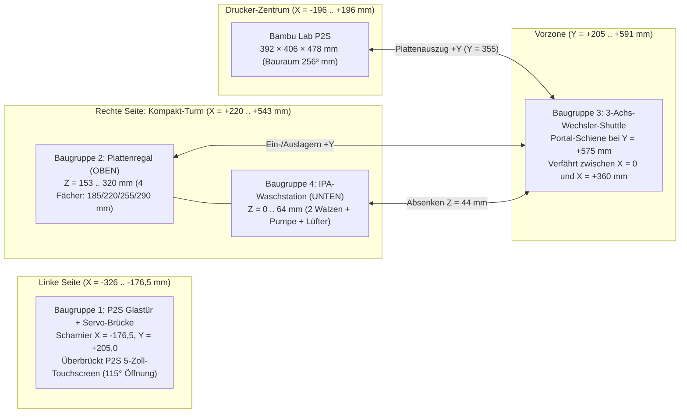

# PrintLab – Konstruktions- & Maßplan für Bambu Lab P2S (Baugruppen 1 bis 4)
> [!IMPORTANT]
> **Ablauf: Die fertigen Teile bleiben auf der Platte.** Der Wechsler zieht die Platte samt Teilen aus dem Drucker und stellt sie
> ins Plattenregal; die Teile werden dort von Hand entnommen. Es wird nichts abgeschoben, deshalb gibt es **keinen Abschubkeil und
> keine Rutsche mit Schale**: Der Bauplan hat **4 Baugruppen**. Die STL-Dateien `bambu_toolhead_sweeper_blade.stl` und
> `bambu_bed_ejection_chute.stl` liegen noch im Ordner, gehören aber nicht mehr zum Bauplan. Die Teilehöhe ist durch das Regal
> begrenzt, siehe Abschnitt 4.

## Punkt-für-Punkt-Auslegung für den Bambu Lab P2S (`392 × 406 × 478 mm`): Türöffner (links über 5"-Touchscreen), Kompakt-Turm rechts (Plattenregal + Waschstation), 3-Achs-Wechsler-Shuttle

> [!IMPORTANT]
> **Spezifische Anpassungen für den Bambu Lab P2S (Stand v2.4 – 4 Baugruppen):**
> * **Drucker-Außenmaße Bambu Lab P2S:** **$392\text{ mm}$ (Breite $X$) $\times 406\text{ mm}$ (Tiefe $Y$) $\times 478\text{ mm}$ (Höhe $Z$)** bei **$256 \times 256 \times 256\text{ mm}$** Bauraum ($257 \times 257\text{ mm}$ Federstahlplatten).
> * **Ursprung $(0, 0, 0)$:** Bodenmitte des Bambu Lab P2S ($X \in [-196{,}0, +196{,}0]\text{ mm}$, $Y \in [-203{,}0, +203{,}0]\text{ mm}$, $Z \in [0, 478{,}0]\text{ mm}$).
> * **Baugruppe 1 (P2S Glastür & Servo-Brücke links):** Scharnier links bei $X = -176{,}5\text{ mm}, Y = +205{,}0\text{ mm}$ (Türbreite $353\text{ mm}$). Der Servohalter auf $Z = 478\text{ mm}$ besitzt einen **$14\text{ mm}$ Frontüberstand**, damit die $90\text{ mm}$ Schubstange frei vor dem **5-Zoll-Touchscreen** des P2S ($Z = 444\dots 475\text{ mm}$) läuft.
> * **Baugruppen 2 & 4 (Kompakt-Turm rechts bei $X = +360\text{ mm}, Y = 0\text{ mm}$):**
>   * **Oben ($Z = 153\dots 320\text{ mm}$):** 4-Fach-Plattenregal (`Baugruppe 2`) mit **Fach 2 exakt auf P2S-Bettübergabehöhe ($Z = 220\text{ mm}$)**.
>   * **Unten ($Z = 0\dots 64\text{ mm}$):** Integrierte IPA-Waschstation (`Baugruppe 4`) direkt unter dem Plattenregal.
> * **Baugruppe 3 (3-Achs-Wechsler-Shuttle):** Wegen der größeren P2S-Gehäusetiefe ($406\text{ mm}$, Türschwenkbogen bis $Y = +558\text{ mm}$) auf **$Y_{\text{Rail}} = +575\text{ mm}$** vorgerückt ($17\text{ mm}$ Sicherheitsabstand vor der offenen P2S-Glastür).

---

## 1. P2S-Koordinatensystem & Maßvergleich (X1C/P1S vs. Bambu Lab P2S)

| Systemgröße | Früher (X1C / P1S) | **Neu: Bambu Lab P2S** | Technische Begründung für den P2S |
| :--- | :--- | :--- | :--- |
| **Drucker-Außenkorpus $(B \times T \times H)$** | $389 \times 389 \times 457\text{ mm}$ | **$392 \times 406 \times 478\text{ mm}$** | P2S ist $+3\text{ mm}$ breiter, $+17\text{ mm}$ tiefer und $+21\text{ mm}$ höher |
| **Gesamt-Aufstellfläche $(B \times T \times H)$** | $928 \times 775 \times 500\text{ mm}$ | **$938 \times 795 \times 518\text{ mm}$** | $X \in [-395, +543]\text{ mm}$, $Y \in [-203, +592]\text{ mm}$, $Z \in [0, 518]\text{ mm}$ |
| **Glastür-Scharnier (links) & Breite** | $(-175{,}0, +196{,}5)$, $B = 350\text{ mm}$ | **$(-176{,}5, +205{,}0)$, $B = 353\text{ mm}$** | Max. Tür-Ausladung bei $90^\circ$: $Y_{\max} = 205 + 353 = \mathbf{558{,}0\text{ mm}}$ |
| **Shuttle-Portalschiene $Y_{\text{Rail}}$** | $Y = +560{,}0\text{ mm}$ | **$Y = +575{,}0\text{ mm}$** | $17{,}0\text{ mm}$ Sicherheitsabstand vor dem $558\text{ mm}$ P2S-Türbogen |
| **Transfer-Korridor $Y_{\text{Transfer}}$** | $Y = +345{,}0\text{ mm}$ | **$Y = +355{,}0\text{ mm}$** | Plattenhinterkante bei $226{,}5\text{ mm}$ ($21{,}5\text{ mm}$ frei vor P2S-Front $205\text{ mm}$) |
| **Kompakt-Turm-Mitte $X_{\text{Mag}}$** | $X = +355{,}0\text{ mm}$ | **$X = +360{,}0\text{ mm}$** | $24{,}0\text{ mm}$ Vibrationsabstand zur rechten P2S-Seitenwand ($X = +196\text{ mm}$) |
| **4 Regalfach-Höhen `SLOT_Z`** | $180 / 215 / 250 / 285\text{ mm}$ | **$185 / 220 / 255 / 290\text{ mm}$** | Fach 2 liegt exakt auf P2S-Bettübergabehöhe $Z_{\text{Swap}} = 220{,}0\text{ mm}$ |

---

## 2. Punkt-für-Punkt-Planung der 4 Baugruppen für den Bambu Lab P2S

### Baugruppe 1: P2S Automatischer Türöffner (Scharnier links, über 5"-Touchscreen)
* **Einbauposition am P2S:** Oben links auf dem P2S-Rahmenprofil direkt über der linken Tür-Drehachse ($X = -186\dots -132\text{ mm}$, $Y = +170\dots +212\text{ mm}$, $Z = 478\dots 504\text{ mm}$).
* **Besonderheit beim Bambu Lab P2S (5-Zoll-Touchscreen):**
  * Der P2S besitzt oben links in der Frontblende ($X = -188\dots -92\text{ mm}, Z = 444\dots 475\text{ mm}$) das vorstehende **5-Zoll-Touchdisplay**.
  * Deshalb kragt der P2S-Servohalter um **$14{,}0\text{ mm}$ nach vorne ($+Y$)** über die obere Rahmenkante aus (Abtriebswelle bei $X = -148\text{ mm}, Y = +210\text{ mm}, Z = 508\text{ mm}$), sodass die Kniehebelstange frei vor dem Touchscreen zur Glastür-Oberkante ($Z = 442\text{ mm}$) verläuft.
* **Einzelteile & exakte Maße:**
  1. **P2S Servo-Halterblock (`bambu_door_opener_servo_bracket.stl`):**
     * Außenmaße: **$54 \times 42 \times 26\text{ mm}$** (Wandstärke $4{,}0\text{ mm}$, Material **ASA** oder **PETG**, $4\text{ Wände}$, $35\,\%$ Gyroid-Infill).
     * Servotasche: $23{,}2 \times 12{,}6 \times 18{,}0\text{ mm}$ (Passung $+0{,}2\text{ mm}$ für Metallgetriebe-Servo **MG90S**).
  2. **Servohorn (Antriebshebel):**
     * Wirksame Hebellänge: $L_1 = 28{,}0\text{ mm}$ (Aluminium-Servoarm 25T auf MG90S-Abtriebswelle).
  3. **P2S Kniehebel-Schubstange (`bambu_door_push_pull_linkage.stl`):**
     * Länge von Auge zu Auge: **$L_2 = 90{,}0\text{ mm}$** (Gesamtlänge $101\text{ mm}$, Querschnitt $8{,}0 \times 5{,}0\text{ mm}$, beidseitig $\varnothing 3{,}05\text{ mm}$ Bohrung für M3-Kugelgelenke).
     * Tür-Anlenkpunkt: **$75{,}0\text{ mm}$** vom linken P2S-Scharnier entlang der Türoberkante ($Z = 442\text{ mm}$) mit 3M-VHB-Acrylklebeband + Klemmclip an der Glastür fixiert.

---

### Baugruppe 2: Plattenregal (4-Fach-Magazin im Kompakt-Turm oben)
* **Einbauposition:** Rechts neben dem Bambu Lab P2S im Obergeschoss des Kompakt-Turms ($X = +220\dots +500\text{ mm}$, Plattenmitte **$X = +360\text{ mm}$**, $Y = -145\dots +145\text{ mm}$, $Z = 153\dots 320\text{ mm}$).
* **Tragrahmen (Kompakt-Turm-Grundgestell für Baugruppe 2 + 4):**
  * **4× Vertikal-Steher:** Aluminiumprofil **2020 I-Typ Nut 5**, Länge jeweils **$320{,}0\text{ mm}$** an den Ecken $(+220, -145)$, $(+220, +135)$, $(+490, -145)$, $(+490, +135)$.
  * **Zwischenboden (Dampfsperre über der Waschstation):** $280 \times 290 \times 8\text{ mm}$ auf Höhe $Z = 153\dots 161\text{ mm}$.
  * **Deckelplatte:** $280 \times 290 \times 8\text{ mm}$ auf Höhe $Z = 312\dots 320\text{ mm}$.
* **Fächer-Geometrie (`plate_magazine_rack_tower.stl`):**
  * **Lichte Innenbreite:** $266{,}0\text{ mm}$ mit $45^\circ$-Zentriertrichtern auf $258{,}5\text{ mm}$ Führungsmaß für die $257 \times 257 \times 0{,}5\text{ mm}$ Bambu-Federstahlplatten.
  * **Exakte P2S Slot-Höhen (Plattenoberkante $Z$):**
    * **Fach 1:** $Z_1 = 185{,}0\text{ mm}$ (Auflageleiste Oberkante bei $Z = 183{,}5\text{ mm}$)
    * **Fach 2:** $Z_2 = 220{,}0\text{ mm}$ (**exakt gleich der P2S-Bettübergabehöhe $Z_{\text{Swap}} = 220{,}0\text{ mm}$** $\Rightarrow$ 0 mm Z-Hub beim Direktwechsel!)
    * **Fach 3:** $Z_3 = 255{,}0\text{ mm}$ (Rastermaß $\Delta Z = 35{,}0\text{ mm}$)
    * **Fach 4:** $Z_4 = 290{,}0\text{ mm}$ (Rastermaß $\Delta Z = 35{,}0\text{ mm}$)
  * **Belegungssensorik:** 4× optische Gabellichtschranke **TCST2103** an der hinteren Anschlagschiene ($Y = -128{,}5\text{ mm}$).

---

### Baugruppe 3: 3-Achs-Plattenwechsler-Shuttle (X/Y/Z-Portal für P2S)
* **Einbauposition:** Vor dem Bambu Lab P2S und dem rechten Kompakt-Turm bei **$Y_{\text{Rail}} = +575{,}0\text{ mm}$** ($X = -160\dots +525\text{ mm}$, $Z = 0\dots 335\text{ mm}$).
* **Achsen-Auslegung & Maße:**
  1. **X-Achse (Horizontaler Querträger zwischen P2S $X = 0$ und Kompakt-Turm $X = +360\text{ mm}$):**
     * **2× Vertikalpfosten:** Alu-Profil **2020**, Länge **$335{,}0\text{ mm}$**, montiert bei $X_{\text{links}} = -152\text{ mm}, Y = +575\text{ mm}$ und $X_{\text{rechts}} = +517\text{ mm}, Y = +575\text{ mm}$.
     * **X-Querträger (fährt auf Z mit):** Alu-Profil **2020**, Länge **$685{,}0\text{ mm}$** ($X = -160\dots +525\text{ mm}$) + Linearschiene **MGN12H ($600\text{ mm}$)**.
     * **Verfahrweg (Netto-Hub X):** $\Delta X = 360{,}0\text{ mm}$ ($X = 0{,}0\text{ mm}$ P2S-Mitte $\leftrightarrow X = +360{,}0\text{ mm}$ Kompakt-Turm-Mitte).
  2. **Z-Achse (Vertikaler Hub für P2S-Heizbett, 4 Regalfächer & Waschstation):**
     * **Führung & Antrieb:** 2× Linearschiene **MGN12H ($300\text{ mm}$)** + Trapezgewindespindel **T8×8 ($300\text{ mm}$)** mit NEMA17-Motor.
     * **Anfahrpositionen Z:**
       * Waschstation-Walzenhöhe: $Z_{\text{Wash}} = 44{,}0\text{ mm}$
       * Regalfächer 1–4: $Z = 185{,}0 / 220{,}0 / 255{,}0 / 290{,}0\text{ mm}$
       * P2S-Heizbett-Übergabehöhe: $Z_{\text{Swap}} = 220{,}0\text{ mm}$
  3. **Y-Achse (Teleskop-Greiferarm durch die offene P2S-Fronttür):**
     * **Führung:** Leichtbau-Linearschiene **MGN9H ($500\text{ mm}$)** auf dem X-Schlitten (mit $440\text{ mm}$ blieben nur $400{,}1\text{ mm}$ Hub, es fehlten $5{,}4\text{ mm}$).
     * **Verfahrweg Y (Greifspitze `gy`):**
       * Parkposition: **$Y_{\text{Park}} = +540{,}0\text{ mm}$** (hinter dem P2S-Türschwenkbogen geparkt).
       * Vorzone (Transferkorridor): Plattenmitte bei **$Y_{\text{Transfer}} = +355{,}0\text{ mm}$** ($21{,}5\text{ mm}$ Sicherheitsabstand zwischen Plattenhinterkante $Y = +226{,}5\text{ mm}$ und P2S-Frontrahmen $Y = +205{,}0\text{ mm}$).
       * Greifposition am P2S-Heizbett / im Regalfach / in der Waschstation: Plattenmitte bei $Y = 0{,}0\text{ mm}$, Greiferbacke bei $Y_{\text{Grip}} = +134{,}5\text{ mm}$ (**Netto-Teleskophub $\Delta Y = 405{,}5\text{ mm}$**).

---

### Baugruppe 4: IPA-Platten-Waschstation (im Kompakt-Turm unten)
* **Einbauposition:** Im Untergeschoss des rechten Kompakt-Turms direkt unter dem Plattenregal ($X = +230\dots +490\text{ mm}$, Mitte **$X = +360\text{ mm}$**, $Y = -140\dots +140\text{ mm}$, $Z = 0\dots 64\text{ mm}$).
* **Einzelteile & exakte Maße (`plate_washer_station_basin.stl`):**
  1. **Chemikalienbeständige Waschwanne (PETG / PP, 5 Wände):**
     * Außenmaß Wanne: $260 \times 280 \times 64\text{ mm}$ (Wandstärke $6{,}0\text{ mm}$, vordere Einlauflippe bei $Y = +134\dots +140\text{ mm}$ auf $Z = 32{,}0\text{ mm}$ abgesenkt).
  2. **2× Gegenläufige Mikrofaser-Schrubbwalzen:**
     * Walze 1 bei $Y = -45{,}0\text{ mm}$, Walze 2 bei $Y = +45{,}0\text{ mm}$, Wellenachse auf $Z = 32{,}0\text{ mm}$, Außendurchmesser $\varnothing 24{,}0\text{ mm}$ (Walzenoberkante $Z = 44{,}0\text{ mm}$), Länge $246\text{ mm}$ ($X = +237\dots +483\text{ mm}$) auf $\varnothing 8\text{ mm}$ Edelstahlwellen in $4 \times$ Kugellagern **608ZZ**, angetrieben über **12V N20-Getriebemotor** (GPIO 26).
  3. **IPA-Sprühsystem & Trocknungsgebläse ($X = +503\dots +543\text{ mm}$):**
     * **12V Peristaltikpumpe** ($40 \times 60 \times 48\text{ mm}$, GPIO 19) + $250\text{ ml}$ IPA-Flasche + **12V Radiallüfter 5015** ($40 \times 65 \times 54\text{ mm}$ Luftleitdüse, GPIO 13).

---

## 3. Vollständige Zuschnitt- & Stückliste (BOM für Bambu Lab P2S)

### A. 3D-Druckteile (für Bambu Lab P2S generiert in `werkzeuge/automation_hardware/models_stl/`)

| Nr. | Baugruppe | STL-Datei | P2S-Außenmaße $(B \times T \times H)$ | Material | Wände / Infill |
| :---: | :--- | :--- | :--- | :---: | :---: |
| **1a** | 1 · P2S Türöffner | [`bambu_door_opener_servo_bracket.stl`](file:///C:/Users/lukas/OneDrive/Desktop/Bambuddy-Fork/werkzeuge/automation_hardware/models_stl/bambu_door_opener_servo_bracket.stl) | **$54 \times 42 \times 26\text{ mm}$** (14 mm Überstand) | ASA / PETG | 4 Wände · 35 % Gyroid |
| **1b** | 1 · P2S Türöffner | [`bambu_door_push_pull_linkage.stl`](file:///C:/Users/lukas/OneDrive/Desktop/Bambuddy-Fork/werkzeuge/automation_hardware/models_stl/bambu_door_push_pull_linkage.stl) | **$90\text{ mm}$** Stichmaß ($101 \times 16 \times 7\text{ mm}$) | ASA / PETG | 5 Wände · 50 % Linien |
| **2** | 2 · Plattenregal | [`plate_magazine_rack_tower.stl`](file:///C:/Users/lukas/OneDrive/Desktop/Bambuddy-Fork/werkzeuge/automation_hardware/models_stl/plate_magazine_rack_tower.stl) | **$280 \times 290 \times 167\text{ mm}$** (Slots 185..290) | PETG | 4 Wände · 30 % Gyroid |
| **4** | 4 · Waschstation | [`plate_washer_station_basin.stl`](file:///C:/Users/lukas/OneDrive/Desktop/Bambuddy-Fork/werkzeuge/automation_hardware/models_stl/plate_washer_station_basin.stl) | **$260 \times 280 \times 64\text{ mm}$** | PETG / PP | 5 Wände · 35 % (dicht) |

### B. Aluminium-Profile, Lineartechnik & Mechanik (P2S-Zuschnittliste)

| Pos. | Bauteil / Halbzeug | Exakte P2S-Spezifikation & Zuschnittmaß | Menge | Verwendung |
| :---: | :--- | :--- | :---: | :--- |
| **M1** | Alu-Profil 2020 Nut 5 | Länge **$320{,}0\text{ mm}$** (stirnseitig M5 Gewinde) | 4 Stk. | Ecksteher Kompakt-Turm rechts neben P2S |
| **M2** | Alu-Profil 2020 Nut 5 | Länge **$335{,}0\text{ mm}$** | 2 Stk. | Vertikalsteher Wechsler-Shuttle ($X = -152 / +517$) |
| **M3** | Alu-Profil 2020 Nut 5 | Länge **$685{,}0\text{ mm}$** | 1 Stk. | Horizontaler X-Querträger Shuttle ($Y = +575$) |
| **M4** | Linearschiene MGN12H | Länge **$600{,}0\text{ mm}$** inkl. 1× Wagen MGN12H | 1 Satz | X-Achse Wechsler-Shuttle ($\Delta X = 360\text{ mm}$) |
| **M5** | Linearschiene MGN12H | Länge **$300{,}0\text{ mm}$** inkl. je 1× Wagen MGN12H | 2 Sätze | Z-Achse Vertikalhub Shuttle (links & rechts) |
| **M6** | Linearschiene MGN9H | Länge **$500{,}0\text{ mm}$** inkl. 1× Wagen MGN9H | 1 Satz | Y-Teleskoparm ($\Delta Y = 405{,}5\text{ mm}$ in den P2S) |
| **M7** | Trapezgewindespindel | **T8×8**, Länge **$300{,}0\text{ mm}$** + Anti-Backlash-Mutter | 1 Satz | Z-Hub-Antrieb Shuttle ($Z = 44\dots 290\text{ mm}$) |
| **M8** | GT2 Zahnriemen + Pulleys | Breite $6\text{ mm}$, Länge **$2500\text{ mm}$** + $2 \times$ 20T Pulley ($\varnothing 5\text{ mm}$) | 1 Satz | Antrieb X-Achse & Y-Teleskoparm |
| **M9** | Edelstahlwellen $\varnothing 8\text{ mm}$ | Länge **$260{,}0\text{ mm}$** (Passung h6) | 2 Stk. | Walzenachsen in der IPA-Waschstation |
| **M10** | Kugellager 608ZZ | $\varnothing 8 \times \varnothing 22 \times 7\text{ mm}$ (gedichtet) | 4 Stk. | Walzenlagerung in der Waschstation |
| **M11** | Mikrofaser-Hülsen | $\varnothing_{\text{außen}} 24\text{ mm}$, $\varnothing_{\text{innen}} 8\text{ mm}$, Länge **$246\text{ mm}$** | 2 Stk. | Gegenläufige Reinigungs-Walzen |
| **M12** | Schraubensatz & Inserts | Ruthex M3 (10×), M3×10/12 (20×), M4×10 + Nutenstein (30×) | 1 Satz | Gesamtverschraubung Baugruppen 1–4 |

### C. Aktuatorik, Pumpen & Elektronik (GPIO-Zuordnung)

| Pos. | Komponente | Technische Daten | Steuerung / Raspberry Pi Pin | Funktion am Bambu Lab P2S |
| :---: | :--- | :--- | :--- | :--- |
| **E1** | Metall-Servo **MG90S** | $4{,}8\dots 6{,}0\text{ V}$, Stellmoment $2{,}2\text{ kg}\cdot\text{cm}$ | **BCM 18 (Pin 12)** – Hardware-PWM | P2S-Türöffner links ($0^\circ \leftrightarrow 115^\circ$) |
| **E2** | 3× Schrittmotor **NEMA17** | $1{,}8^\circ$, $1{,}5\text{ A}$ + 3× Treiber **TMC2209** | UART / Step-Dir Controller | Shuttle-Achsen $X$ ($360\text{ mm}$), $Y$ ($405{,}5\text{ mm}$), $Z$ |
| **E3** | Elektromagnet-Greifer | 12V DC, $80\text{ N}$ Haltekraft ($\varnothing 25 \times 20\text{ mm}$) | Relais / MOSFET | Greift die Vorderkante der $257\text{ mm}$ Federstahlplatte |
| **E4** | Getriebemotor **N20 12V** | $150\text{ U/min}$, hohes Drehmoment | **BCM 26 (Pin 37)** – Relais Kanal 1 | Treibt die 2 Mikrofaser-Walzen gegenläufig an |
| **E5** | **Peristaltikpumpe 12V** | $80\text{ ml/min}$, IPA-beständiger Silikonschlauch | **BCM 19 (Pin 35)** – Relais Kanal 2 | Dosiert Isopropanol ($99{,}9\,\%$) auf die Platte |
| **E6** | **Radiallüfter 5015 12V** | $50 \times 50 \times 15\text{ mm}$, $6000\text{ U/min}$ | **BCM 13 (Pin 33)** – Relais Kanal 3 | Trocknet die gewaschene Platte in $15\text{ s}$ |
| **E7** | 4× Lichtschranke **TCST2103** | Optischer Slot-Sensor $3{,}3\text{ V}$ | GPIO-Eingänge (Fächer 1–4) | Erkennt belegte/freie Fächer im Plattenregal |
| **E8** | Netzteil MeanWell **LRS-100-12** | 12V DC / $8{,}5\text{ A}$ ($100\text{ W}$) + 5V/3A Buck-Converter | Primärversorgung | Versorgt Motoren, Pumpe, Magnet, Lüfter & Servo |

---

## 4. Wechselzyklus und Konstruktionsprüfung (Baugruppe 3)

Die Maße und der Ablauf stehen **einmal** im Code: `backend/app/services/plate_changer.py`. Die Plattenstation fährt diese Phasen ab,
die 3D-Ansicht trägt eine Kopie und ein Test (`test_plate_changer.py`) schlägt fehl, wenn beide auseinanderlaufen. Nach einer
Änderung der Maße oder Phasen: `python werkzeuge/automation_hardware/sync_viewer.py` und die HTML-Datei mitcommitten.
Die Maße stammen aus diesem Plan und sind **nicht am Gerät nachgemessen**.

### 4.1 Die 11 Phasen eines Wechsels

| Nr. | Phase | Was passiert | Magnet |
| :---: | :--- | :--- | :---: |
| 1 | Tür öffnet | Servo öffnet die Glastür auf $115^\circ$ | – |
| 2 | Bett fährt auf Wechselhöhe | Bett senkt sich auf $Z = 220$, die Teile bleiben auf der Platte | – |
| 3 | Shuttle vor den Drucker | Shuttle $X$ $360 \to 0$, Arm fährt vor | – |
| 4 | Alte Platte herausziehen | Platte samt Teilen bis $Y = 355$ in den Übergabekorridor | an |
| 5 | Zum Plattenregal | $X$ $0 \to 360$, $Z$ auf das leere Fach | – |
| 6 | Alte Platte ablegen | Platte samt Teilen ins freie Fach schieben | aus |
| 7 | Zur frischen Platte | Arm löst, $Z$ auf das Fach mit der frischen Platte | – |
| 8 | Frische Platte holen | Platte bis $Y = 355$ herausziehen | an |
| 9 | Zurück zum Drucker | $X$ $360 \to 0$, $Z$ auf Wechselhöhe $220$ | – |
| 10 | Platte auf das Bett legen | Platte auf das Heizbett schieben | aus |
| 11 | Parken, Tür schließt | Arm auf $Y = 540$, Shuttle zum Turm, Tür zu, Bett auf Ruhe-$Z$ | – |

**Teile bleiben auf der Platte:** Die Platte kommt mit Status `full` („mit Teilen“) ins Fach. Sie wird erst gewaschen, wenn die Teile
von Hand entnommen und im System als entnommen gemeldet sind (`POST /api/v1/fleet/plate-station/slots/{id}/unload-parts`, in der
3D-Ansicht „entnehmen“); danach ist sie `dirty`. Das Waschen verweigert Platten mit Teilen.

**Reihenfolge ist Pflicht:** Die Tür muss ganz offen sein (Phase 1), bevor die Platte den Drucker verlässt (Phase 4). Bei halber
Öffnung schneidet die Tür den Übergabekorridor. Das rechnet die Prüfung unten nach, die 3D-Ansicht zeigt den Abstand live.

### 4.2 Sperren (Software)

Tür öffnen und Plattenwechsel laufen nur, wenn **kein Druck läuft** (Zustand weder `PREPARE`, `SLICING`, `RUNNING` noch `PAUSE`,
bei unbekanntem Zustand ebenfalls nicht), das **Bett höchstens $36\,^\circ\text{C}$** hat und der **Not-Halt nicht aktiv** ist.
Beim Wechsel prüft die Software außerdem die **Teilehöhe** (`part_height_mm`): Die Teile müssen unter die nächste Platte im Regal passen,
sonst bewegt sich nichts. Ohne Angabe der Höhe wird nicht geprüft; `with_parts: false` für eine Platte ohne Teile.
Waschen und Tür schließen sperrt nur der Not-Halt. Alle Bewegungen verlangen das Recht `printers:control` und werden im
Audit-Protokoll festgehalten. Bei mehreren Druckern muss `printer_id` angegeben werden.

> [!WARNING]
> Die Plattenstation ist derzeit eine **Simulation**: `driver.simulated` ist `true`, es werden keine Motoren, Magnete oder Pumpen
> angesteuert. Ein echter Treiber ersetzt `SimulatedDriver.run_phase` und `abort`; erst dann bewegt sich Hardware.

### 4.3 Konstruktionsprüfung

Erzeugt mit `python werkzeuge/automation_hardware/sync_viewer.py --report` (rechnet nur nach, ob die Maße zueinander passen).

| Prüfung | Wert | Empfohlen | Status | Hinweis |
| :--- | ---: | ---: | :---: | :--- |
| Tür ↔ Portalprofil (Draufsicht, ganzer Öffnungsweg) | 7,3 mm | 15 mm | **KNAPP** | Die 17 mm gelten bis zur Schienenmitte ($Y = 575$), die Profilvorderkante liegt bei $Y = 565$: Schiene auf $Y \ge 583$ setzen oder die Türöffnung am Gerät auf unter $90^\circ$ begrenzen. |
| Tür ($115^\circ$) ↔ Platte im Übergabekorridor | 52,6 mm | 15 mm | ok | Gilt nur bei ganz offener Tür. |
| Plattenhinterkante ↔ Druckerfront im Korridor | 21,5 mm | 15 mm | ok | |
| Turm ↔ rechte Druckerwand | 24,0 mm | 15 mm | ok | |
| Reserve Verfahrweg X | 194,6 mm | 5 mm | ok | |
| Reserve Verfahrweg Y-Arm | 54,6 mm | 5 mm | ok | **Schiene von 440 auf 500 mm geändert**, sonst fehlten 5,4 mm. |
| Reserve Verfahrweg Z | 8,6 mm | 5 mm | ok | Knapp: Spindelmutter und Anschläge brauchen Platz, am Gerät prüfen. |
| Höhe der Teile auf der Platte im niedrigsten Fach | 17,0 mm | 30 mm | **KNAPP** | Fach 1 bis 3: je 29,5 mm (35-mm-Raster minus Platte und 5 mm Luft), Fach 4 unter der Deckplatte: 17 mm. Höhere Teile: Raster vergrößern, Fächer streichen oder das oberste Fach nicht für Platten mit Teilen nutzen. Die gewünschten 30 mm sind eine **Annahme** (Beispielteil der 3D-Ansicht), bitte durch die echte Höchsthöhe ersetzen. |
| Backe in Fach 4 ↔ Deckplatte des Turms | 14,0 mm | 15 mm | **KNAPP** | Backenoberkante 8 mm über der Plattenoberkante, Deckplatte ab $Z = 312$. |
| Haltekraft Magnet ÷ Plattengewicht | 31,5 × | 5 × | ok | Nennwert bei 80 N: Eine dünne Platte nutzt nur einen Bruchteil, mit der Federwaage prüfen. |

### 4.4 Noch nicht ausgearbeitet

* Für das Shuttle gibt es **keine gedruckten Teile** (Wagenplatten, Greiferkopf mit Magnettasche, Riemenhalter, Endschalter-Fahnen,
  Kettenaufnahme). Der Greifer ist in der 3D-Ansicht nur als Block gezeichnet.
* Die Teile werden **von Hand** von den Platten im Regal genommen; eine Entnahme-Automatik gibt es nicht.
* Referenzfahrt, Endschalter und Schrittverluste sind nicht beschrieben; ohne sie darf der echte Treiber nicht in Betrieb gehen.
* Die Fahrgeschwindigkeiten und damit die Dauer eines Wechsels sind nicht festgelegt; die Dauer in der 3D-Ansicht ist nur Anschauung.
