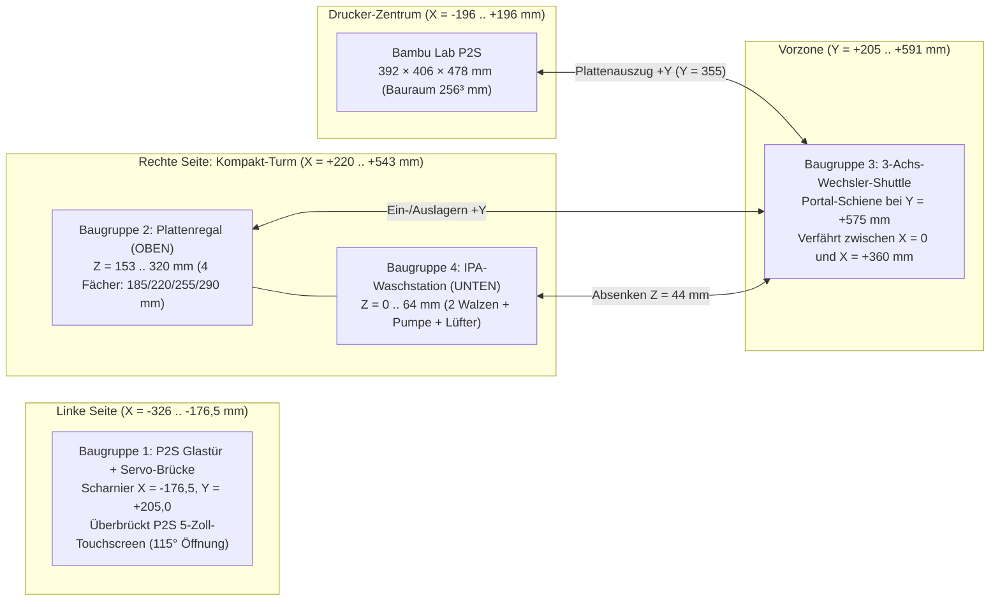

# PrintLab – Konstruktions- & Maßplan für Bambu Lab P2S (Baugruppen 1 bis 4)
> Abschnitt 5 bis 10: Einzelteile, Elektrik, Antriebe, Fahrzeiten, Strom, Aufbau. Die Tabellen erzeugt `sync_viewer.py --plan`.

> [!IMPORTANT]
> **Ablauf: Die fertigen Teile bleiben auf der Platte.** Der Wechsler zieht die Platte samt Teilen aus dem Drucker und stellt sie
> ins Plattenregal; die Teile werden dort von Hand entnommen. Es wird nichts abgeschoben, deshalb gibt es **keinen Abschubkeil und
> keine Rutsche mit Schale**: Der Bauplan hat **4 Baugruppen**. Die STL-Dateien `bambu_toolhead_sweeper_blade.stl` und
> `bambu_bed_ejection_chute.stl` liegen noch im Ordner, gehören aber nicht mehr zum Bauplan. Die Teilehöhe ist durch das Regal
> begrenzt, siehe Abschnitt 4.

## Punkt-für-Punkt-Auslegung für den Bambu Lab P2S (`392 × 406 × 478 mm`): Türöffner (links über 5"-Touchscreen), Kompakt-Turm rechts (Plattenregal + Waschstation), 3-Achs-Wechsler-Shuttle

> [!IMPORTANT]
> **Spezifische Anpassungen für den Bambu Lab P2S (Stand v2.4 – 4 Baugruppen):**
> * **Drucker-Außenmaße Bambu Lab P2S:** **$392\text{ mm}$ (Breite $X$) $\times 406\text{ mm}$ (Tiefe $Y$) $\times 478\text{ mm}$ (Höhe $Z$)** bei **$256 \times 256 \times 256\text{ mm}$** Bauraum ($257 \times 257\text{ mm}$ Federstahlplatten).
> * **Ursprung $(0, 0, 0)$:** Bodenmitte des Bambu Lab P2S ($X \in [-196{,}0, +196{,}0]\text{ mm}$, $Y \in [-203{,}0, +203{,}0]\text{ mm}$, $Z \in [0, 478{,}0]\text{ mm}$).
> * **Baugruppe 1 (P2S Glastür & Servo-Brücke links):** Scharnier links bei $X = -176{,}5\text{ mm}, Y = +205{,}0\text{ mm}$ (Türbreite $353\text{ mm}$). Der Servohalter auf $Z = 478\text{ mm}$ besitzt einen **$14\text{ mm}$ Frontüberstand**, damit die $90\text{ mm}$ Schubstange frei vor dem **5-Zoll-Touchscreen** des P2S ($Z = 444\dots 475\text{ mm}$) läuft.
> * **Baugruppen 2 & 4 (Kompakt-Turm rechts bei $X = +360\text{ mm}, Y = 0\text{ mm}$):**
>   * **Oben ($Z = 153\dots 320\text{ mm}$):** 4-Fach-Plattenregal (`Baugruppe 2`) mit **Fach 2 exakt auf P2S-Bettübergabehöhe ($Z = 220\text{ mm}$)**.
>   * **Unten ($Z = 0\dots 64\text{ mm}$):** Integrierte IPA-Waschstation (`Baugruppe 4`) direkt unter dem Plattenregal.
> * **Baugruppe 3 (3-Achs-Wechsler-Shuttle):** Wegen der größeren P2S-Gehäusetiefe ($406\text{ mm}$, Türschwenkbogen bis $Y = +558\text{ mm}$) auf **$Y_{\text{Rail}} = +575\text{ mm}$** vorgerückt ($17\text{ mm}$ Sicherheitsabstand vor der offenen P2S-Glastür).

---

## 1. P2S-Koordinatensystem & Maßvergleich (X1C/P1S vs. Bambu Lab P2S)

| Systemgröße | Früher (X1C / P1S) | **Neu: Bambu Lab P2S** | Technische Begründung für den P2S |
| :--- | :--- | :--- | :--- |
| **Drucker-Außenkorpus $(B \times T \times H)$** | $389 \times 389 \times 457\text{ mm}$ | **$392 \times 406 \times 478\text{ mm}$** | P2S ist $+3\text{ mm}$ breiter, $+17\text{ mm}$ tiefer und $+21\text{ mm}$ höher |
| **Gesamt-Aufstellfläche $(B \times T \times H)$** | $928 \times 775 \times 500\text{ mm}$ | **$938 \times 795 \times 518\text{ mm}$** | $X \in [-395, +543]\text{ mm}$, $Y \in [-203, +592]\text{ mm}$, $Z \in [0, 518]\text{ mm}$ |
| **Glastür-Scharnier (links) & Breite** | $(-175{,}0, +196{,}5)$, $B = 350\text{ mm}$ | **$(-176{,}5, +205{,}0)$, $B = 353\text{ mm}$** | Max. Tür-Ausladung bei $90^\circ$: $Y_{\max} = 205 + 353 = \mathbf{558{,}0\text{ mm}}$ |
| **Shuttle-Portalschiene $Y_{\text{Rail}}$** | $Y = +560{,}0\text{ mm}$ | **$Y = +575{,}0\text{ mm}$** | $17{,}0\text{ mm}$ Sicherheitsabstand vor dem $558\text{ mm}$ P2S-Türbogen |
| **Transfer-Korridor $Y_{\text{Transfer}}$** | $Y = +345{,}0\text{ mm}$ | **$Y = +355{,}0\text{ mm}$** | Plattenhinterkante bei $226{,}5\text{ mm}$ ($21{,}5\text{ mm}$ frei vor P2S-Front $205\text{ mm}$) |
| **Kompakt-Turm-Mitte $X_{\text{Mag}}$** | $X = +355{,}0\text{ mm}$ | **$X = +360{,}0\text{ mm}$** | $24{,}0\text{ mm}$ Vibrationsabstand zur rechten P2S-Seitenwand ($X = +196\text{ mm}$) |
| **4 Regalfach-Höhen `SLOT_Z`** | $180 / 215 / 250 / 285\text{ mm}$ | **$185 / 220 / 255 / 290\text{ mm}$** | Fach 2 liegt exakt auf P2S-Bettübergabehöhe $Z_{\text{Swap}} = 220{,}0\text{ mm}$ |

---

## 2. Punkt-für-Punkt-Planung der 4 Baugruppen für den Bambu Lab P2S

### Baugruppe 1: P2S Automatischer Türöffner (Scharnier links, über 5"-Touchscreen)
* **Einbauposition am P2S:** Oben links auf dem P2S-Rahmenprofil direkt über der linken Tür-Drehachse ($X = -186\dots -132\text{ mm}$, $Y = +170\dots +212\text{ mm}$, $Z = 478\dots 504\text{ mm}$).
* **Besonderheit beim Bambu Lab P2S (5-Zoll-Touchscreen):**
  * Der P2S besitzt oben links in der Frontblende ($X = -188\dots -92\text{ mm}, Z = 444\dots 475\text{ mm}$) das vorstehende **5-Zoll-Touchdisplay**.
  * Deshalb kragt der P2S-Servohalter um **$14{,}0\text{ mm}$ nach vorne ($+Y$)** über die obere Rahmenkante aus (Abtriebswelle bei $X = -148\text{ mm}, Y = +210\text{ mm}, Z = 508\text{ mm}$), sodass die Kniehebelstange frei vor dem Touchscreen zur Glastür-Oberkante ($Z = 442\text{ mm}$) verläuft.
* **Einzelteile & exakte Maße:**
  1. **P2S Servo-Halterblock (`bambu_door_opener_servo_bracket.stl`):**
     * Außenmaße: **$54 \times 42 \times 26\text{ mm}$** (Wandstärke $4{,}0\text{ mm}$, Material **ASA** oder **PETG**, $4\text{ Wände}$, $35\,\%$ Gyroid-Infill).
     * Servotasche: $23{,}2 \times 12{,}6 \times 18{,}0\text{ mm}$ (Passung $+0{,}2\text{ mm}$ für Metallgetriebe-Servo **MG90S**).
  2. **Servohorn (Antriebshebel):**
     * Wirksame Hebellänge: $L_1 = 28{,}0\text{ mm}$ (Aluminium-Servoarm 25T auf MG90S-Abtriebswelle).
  3. **P2S Kniehebel-Schubstange (`bambu_door_push_pull_linkage.stl`):**
     * Länge von Auge zu Auge: **$L_2 = 90{,}0\text{ mm}$** (Gesamtlänge $101\text{ mm}$, Querschnitt $8{,}0 \times 5{,}0\text{ mm}$, beidseitig $\varnothing 3{,}05\text{ mm}$ Bohrung für M3-Kugelgelenke).
     * Tür-Anlenkpunkt: **$75{,}0\text{ mm}$** vom linken P2S-Scharnier entlang der Türoberkante ($Z = 442\text{ mm}$) mit 3M-VHB-Acrylklebeband + Klemmclip an der Glastür fixiert.

---

### Baugruppe 2: Plattenregal (4-Fach-Magazin im Kompakt-Turm oben)
* **Einbauposition:** Rechts neben dem Bambu Lab P2S im Obergeschoss des Kompakt-Turms ($X = +220\dots +500\text{ mm}$, Plattenmitte **$X = +360\text{ mm}$**, $Y = -145\dots +145\text{ mm}$, $Z = 153\dots 320\text{ mm}$).
* **Tragrahmen (Kompakt-Turm-Grundgestell für Baugruppe 2 + 4):**
  * **4× Vertikal-Steher:** Aluminiumprofil **2020 I-Typ Nut 5**, Länge jeweils **$320{,}0\text{ mm}$** an den Ecken $(+220, -145)$, $(+220, +135)$, $(+490, -145)$, $(+490, +135)$.
  * **Zwischenboden (Dampfsperre über der Waschstation):** $280 \times 290 \times 8\text{ mm}$ auf Höhe $Z = 153\dots 161\text{ mm}$.
  * **Deckelplatte:** $280 \times 290 \times 8\text{ mm}$ auf Höhe $Z = 312\dots 320\text{ mm}$.
* **Fächer-Geometrie (`plate_magazine_rack_tower.stl`):**
  * **Lichte Innenbreite:** $266{,}0\text{ mm}$ mit $45^\circ$-Zentriertrichtern auf $258{,}5\text{ mm}$ Führungsmaß für die $257 \times 257 \times 0{,}5\text{ mm}$ Bambu-Federstahlplatten.
  * **Exakte P2S Slot-Höhen (Plattenoberkante $Z$):**
    * **Fach 1:** $Z_1 = 185{,}0\text{ mm}$ (Auflageleiste Oberkante bei $Z = 183{,}5\text{ mm}$)
    * **Fach 2:** $Z_2 = 220{,}0\text{ mm}$ (**exakt gleich der P2S-Bettübergabehöhe $Z_{\text{Swap}} = 220{,}0\text{ mm}$** $\Rightarrow$ 0 mm Z-Hub beim Direktwechsel!)
    * **Fach 3:** $Z_3 = 255{,}0\text{ mm}$ (Rastermaß $\Delta Z = 35{,}0\text{ mm}$)
    * **Fach 4:** $Z_4 = 290{,}0\text{ mm}$ (Rastermaß $\Delta Z = 35{,}0\text{ mm}$)
  * **Belegungssensorik:** 4× optische Gabellichtschranke **TCST2103** an der hinteren Anschlagschiene ($Y = -128{,}5\text{ mm}$).

---

### Baugruppe 3: 3-Achs-Plattenwechsler-Shuttle (X/Y/Z-Portal für P2S)
* **Einbauposition:** Vor dem Bambu Lab P2S und dem rechten Kompakt-Turm bei **$Y_{\text{Rail}} = +575{,}0\text{ mm}$** ($X = -160\dots +525\text{ mm}$, $Z = 0\dots 335\text{ mm}$).
* **Achsen-Auslegung & Maße:**
  1. **X-Achse (Horizontaler Querträger zwischen P2S $X = 0$ und Kompakt-Turm $X = +360\text{ mm}$):**
     * **2× Vertikalpfosten:** Alu-Profil **2020**, Länge **$335{,}0\text{ mm}$**, montiert bei $X_{\text{links}} = -152\text{ mm}, Y = +575\text{ mm}$ und $X_{\text{rechts}} = +517\text{ mm}, Y = +575\text{ mm}$.
     * **X-Querträger (fährt auf Z mit):** Alu-Profil **2020**, Länge **$685{,}0\text{ mm}$** ($X = -160\dots +525\text{ mm}$) + Linearschiene **MGN12H ($600\text{ mm}$)**.
     * **Verfahrweg (Netto-Hub X):** $\Delta X = 360{,}0\text{ mm}$ ($X = 0{,}0\text{ mm}$ P2S-Mitte $\leftrightarrow X = +360{,}0\text{ mm}$ Kompakt-Turm-Mitte).
  2. **Z-Achse (Vertikaler Hub für P2S-Heizbett, 4 Regalfächer & Waschstation):**
     * **Führung & Antrieb:** 2× Linearschiene **MGN12H ($300\text{ mm}$)** + Trapezgewindespindel **T8×8 ($300\text{ mm}$)** mit NEMA17-Motor.
     * **Anfahrpositionen Z:**
       * Waschstation-Walzenhöhe: $Z_{\text{Wash}} = 44{,}0\text{ mm}$
       * Regalfächer 1–4: $Z = 185{,}0 / 220{,}0 / 255{,}0 / 290{,}0\text{ mm}$
       * P2S-Heizbett-Übergabehöhe: $Z_{\text{Swap}} = 220{,}0\text{ mm}$
  3. **Y-Achse (Teleskop-Greiferarm durch die offene P2S-Fronttür):**
     * **Führung:** Leichtbau-Linearschiene **MGN9H ($500\text{ mm}$)** auf dem X-Schlitten (mit $440\text{ mm}$ blieben nur $400{,}1\text{ mm}$ Hub, es fehlten $5{,}4\text{ mm}$).
     * **Verfahrweg Y (Greifspitze `gy`):**
       * Parkposition: **$Y_{\text{Park}} = +540{,}0\text{ mm}$** (hinter dem P2S-Türschwenkbogen geparkt).
       * Vorzone (Transferkorridor): Plattenmitte bei **$Y_{\text{Transfer}} = +355{,}0\text{ mm}$** ($21{,}5\text{ mm}$ Sicherheitsabstand zwischen Plattenhinterkante $Y = +226{,}5\text{ mm}$ und P2S-Frontrahmen $Y = +205{,}0\text{ mm}$).
       * Greifposition am P2S-Heizbett / im Regalfach / in der Waschstation: Plattenmitte bei $Y = 0{,}0\text{ mm}$, Greiferbacke bei $Y_{\text{Grip}} = +134{,}5\text{ mm}$ (**Netto-Teleskophub $\Delta Y = 405{,}5\text{ mm}$**).

---

### Baugruppe 4: IPA-Platten-Waschstation (im Kompakt-Turm unten)
* **Einbauposition:** Im Untergeschoss des rechten Kompakt-Turms direkt unter dem Plattenregal ($X = +230\dots +490\text{ mm}$, Mitte **$X = +360\text{ mm}$**, $Y = -140\dots +140\text{ mm}$, $Z = 0\dots 64\text{ mm}$).
* **Einzelteile & exakte Maße (`plate_washer_station_basin.stl`):**
  1. **Chemikalienbeständige Waschwanne (PETG / PP, 5 Wände):**
     * Außenmaß Wanne: $260 \times 280 \times 64\text{ mm}$ (Wandstärke $6{,}0\text{ mm}$, vordere Einlauflippe bei $Y = +134\dots +140\text{ mm}$ auf $Z = 32{,}0\text{ mm}$ abgesenkt).
  2. **2× Gegenläufige Mikrofaser-Schrubbwalzen:**
     * Walze 1 bei $Y = -45{,}0\text{ mm}$, Walze 2 bei $Y = +45{,}0\text{ mm}$, Wellenachse auf $Z = 32{,}0\text{ mm}$, Außendurchmesser $\varnothing 24{,}0\text{ mm}$ (Walzenoberkante $Z = 44{,}0\text{ mm}$), Länge $246\text{ mm}$ ($X = +237\dots +483\text{ mm}$) auf $\varnothing 8\text{ mm}$ Edelstahlwellen in $4 \times$ Kugellagern **608ZZ**, angetrieben über **12V N20-Getriebemotor** (GPIO 26).
  3. **IPA-Sprühsystem & Trocknungsgebläse ($X = +503\dots +543\text{ mm}$):**
     * **12V Peristaltikpumpe** ($40 \times 60 \times 48\text{ mm}$, GPIO 19) + $250\text{ ml}$ IPA-Flasche + **12V Radiallüfter 5015** ($40 \times 65 \times 54\text{ mm}$ Luftleitdüse, GPIO 13).

---

## 3. Vollständige Zuschnitt- & Stückliste (BOM für Bambu Lab P2S)

### A. 3D-Druckteile (für Bambu Lab P2S generiert in `werkzeuge/automation_hardware/models_stl/`)

| Nr. | Baugruppe | STL-Datei | P2S-Außenmaße $(B \times T \times H)$ | Material | Wände / Infill |
| :---: | :--- | :--- | :--- | :---: | :---: |
| **1a** | 1 · P2S Türöffner | [`bambu_door_opener_servo_bracket.stl`](file:///C:/Users/lukas/OneDrive/Desktop/Bambuddy-Fork/werkzeuge/automation_hardware/models_stl/bambu_door_opener_servo_bracket.stl) | **$54 \times 42 \times 26\text{ mm}$** (14 mm Überstand) | ASA / PETG | 4 Wände · 35 % Gyroid |
| **1b** | 1 · P2S Türöffner | [`bambu_door_push_pull_linkage.stl`](file:///C:/Users/lukas/OneDrive/Desktop/Bambuddy-Fork/werkzeuge/automation_hardware/models_stl/bambu_door_push_pull_linkage.stl) | **$90\text{ mm}$** Stichmaß ($101 \times 16 \times 7\text{ mm}$) | ASA / PETG | 5 Wände · 50 % Linien |
| **2** | 2 · Plattenregal | [`plate_magazine_rack_tower.stl`](file:///C:/Users/lukas/OneDrive/Desktop/Bambuddy-Fork/werkzeuge/automation_hardware/models_stl/plate_magazine_rack_tower.stl) | **$280 \times 290 \times 167\text{ mm}$** (Slots 185..290) | PETG | 4 Wände · 30 % Gyroid |
| **4** | 4 · Waschstation | [`plate_washer_station_basin.stl`](file:///C:/Users/lukas/OneDrive/Desktop/Bambuddy-Fork/werkzeuge/automation_hardware/models_stl/plate_washer_station_basin.stl) | **$260 \times 280 \times 64\text{ mm}$** | PETG / PP | 5 Wände · 35 % (dicht) |

### B. Aluminium-Profile, Lineartechnik & Mechanik (P2S-Zuschnittliste)

| Pos. | Bauteil / Halbzeug | Exakte P2S-Spezifikation & Zuschnittmaß | Menge | Verwendung |
| :---: | :--- | :--- | :---: | :--- |
| **M1** | Alu-Profil 2020 Nut 5 | Länge **$320{,}0\text{ mm}$** (stirnseitig M5 Gewinde) | 4 Stk. | Ecksteher Kompakt-Turm rechts neben P2S |
| **M2** | Alu-Profil 2020 Nut 5 | Länge **$335{,}0\text{ mm}$** | 2 Stk. | Vertikalsteher Wechsler-Shuttle ($X = -152 / +517$) |
| **M3** | Alu-Profil 2020 Nut 5 | Länge **$685{,}0\text{ mm}$** | 1 Stk. | Horizontaler X-Querträger Shuttle ($Y = +575$) |
| **M4** | Linearschiene MGN12H | Länge **$600{,}0\text{ mm}$** inkl. 1× Wagen MGN12H | 1 Satz | X-Achse Wechsler-Shuttle ($\Delta X = 360\text{ mm}$) |
| **M5** | Linearschiene MGN12H | Länge **$300{,}0\text{ mm}$** inkl. je 1× Wagen MGN12H | 2 Sätze | Z-Achse Vertikalhub Shuttle (links & rechts) |
| **M6** | Linearschiene MGN9H | Länge **$500{,}0\text{ mm}$** inkl. 1× Wagen MGN9H | 1 Satz | Y-Teleskoparm ($\Delta Y = 405{,}5\text{ mm}$ in den P2S) |
| **M7** | Trapezgewindespindel | **Tr8×2** (Steigung 2 mm, selbsthemmend), Länge **$300{,}0\text{ mm}$** + Flanschmutter POM | 2 Sätze | Z-Hub, je Pfosten eine (Abschnitt 5.1; die erste Auslegung Tr8×8 hemmte nicht) |
| **M8** | GT2 Zahnriemen + Pulleys | Breite $6\text{ mm}$, **3 m** Rolle (X etwa 1400 mm, Y etwa 1200 mm, offen mit Klemmen) + 2× 20T Pulley ($\varnothing 5\text{ mm}$) + 2× 20T Umlenkrolle | 1 Satz | Antrieb X-Achse & Y-Teleskoparm |
| **M9** | Edelstahlwellen $\varnothing 8\text{ mm}$ | Länge **$260{,}0\text{ mm}$** (Passung h6) | 2 Stk. | Walzenachsen in der IPA-Waschstation |
| **M10** | Kugellager 608ZZ | $\varnothing 8 \times \varnothing 22 \times 7\text{ mm}$ (gedichtet) | 4 Stk. | Walzenlagerung in der Waschstation |
| **M11** | Mikrofaser-Hülsen | $\varnothing_{\text{außen}} 24\text{ mm}$, $\varnothing_{\text{innen}} 8\text{ mm}$, Länge **$246\text{ mm}$** | 2 Stk. | Gegenläufige Reinigungs-Walzen |
| **M12** | Schraubensatz & Inserts | Ruthex M3 (10×), M3×10/12 (20×), M4×10 + Nutenstein (30×) | 1 Satz | Gesamtverschraubung Baugruppen 1–4 |

### C. Aktuatorik, Pumpen & Elektronik (GPIO-Zuordnung)

| Pos. | Komponente | Technische Daten | Steuerung / Raspberry Pi Pin | Funktion am Bambu Lab P2S |
| :---: | :--- | :--- | :--- | :--- |
| **E1** | Metall-Servo **MG90S** | $4{,}8\dots 6{,}0\text{ V}$, Stellmoment $2{,}2\text{ kg}\cdot\text{cm}$ | **BCM 18 (Pin 12)** – Hardware-PWM | P2S-Türöffner links ($0^\circ \leftrightarrow 115^\circ$) |
| **E2** | **4×** Schrittmotor **NEMA17** | $1{,}8^\circ$, $1{,}5\text{ A}$ + **4×** Treiber **TMC2209** | **Bewegungs-Controller per USB** (Abschnitt 6.1) | Shuttle-Achsen X (360 mm), Y (405,5 mm), Z links und rechts |
| **E3** | Elektromagnet-Greifer | 12V DC, $80\text{ N}$ Haltekraft ($\varnothing 25 \times 20\text{ mm}$) | MOSFET-Ausgang des Bewegungs-Controllers (E9), Sicherung F2 | Greift die Vorderkante der $257\text{ mm}$ Federstahlplatte |
| **E4** | Getriebemotor **N20 12V** | $150\text{ U/min}$, hohes Drehmoment | **BCM 19 (Pin 35)** – Relais Kanal 1 | Treibt die 2 Mikrofaser-Walzen gegenläufig an |
| **E5** | **Peristaltikpumpe 12V** | $80\text{ ml/min}$, IPA-beständiger Silikonschlauch | **BCM 6 (Pin 31)** – Relais Kanal 2 | Dosiert Isopropanol ($99{,}9\,\%$) auf die Platte |
| **E6** | **Radiallüfter 5015 12V** | $50 \times 50 \times 15\text{ mm}$, $6000\text{ U/min}$ | **BCM 13 (Pin 33)** – Relais Kanal 3 | Trocknet die gewaschene Platte in $15\text{ s}$ |
| **E7** | 4× Lichtschranke **TCST2103** | Optischer Slot-Sensor $3{,}3\text{ V}$ | **BCM 4, 5, 12, 7** (Fächer 1–4) | Erkennt belegte/freie Fächer im Plattenregal |
| **E8** | Netzteil MeanWell **LRS-100-12** | 12V DC / $8{,}5\text{ A}$ ($100\text{ W}$) + 5V/3A Buck-Converter | Primärversorgung | Versorgt Motoren, Pumpe, Magnet, Lüfter & Servo |

### D. Ergänzungen aus der Vollplanung (Abschnitte 5 bis 10)

| Pos. | Bauteil | Spezifikation | Menge | Verwendung |
| :---: | :--- | :--- | :---: | :--- |
| **M13** | Alu-Profil 2020 Nut 5 | Länge **500 mm** | 1 Stk. | Y-Träger (3d) |
| **M14** | Alu-Rechteckrohr | 20 × 10 × 1,5 mm, Länge am Aufbau festlegen | 1 Stk. | Greiferarm (3f) |
| **M15** | NEMA17-Winkelhalter | Stahl, Standard | 2 Stk. | Z-Motoren am Pfostenfuß |
| **M16** | Energiekette | innen 10 × 15 mm; 240 / 300 / 320 mm | 3 Stk. | Z, X, Y (Abschnitt 5.1) |
| **M17** | Schleppkettenleitung | geschirmt, 4-adrig 0,34 mm² (Motoren), 0,14 mm² (Signale) | je Bedarf | Motoren, Endschalter, Magnet |
| **E9** | Bewegungs-Controller | 4× TMC2209, USB, Klipper/Marlin | 1 Stk. | X, Y, Z links und rechts, Endschalter, Magnetausgang |
| **E10** | Mikroschalter KW12 | Öffner, Rolle | 5 Stk. | Endschalter X, Y, Z sowie Tür offen und zu |
| **E11** | Kontaktschalter | Mikroschalter mit Hebel | 1 Stk. | „Platte gegriffen“ in der Backe (3g) |
| **E12** | Not-Halt-Taster | Pilzkopf, Ø 22 mm, Öffner, rastend | 1 Stk. | Abschnitt 6.2 |
| **E13** | Sicherungen | 10 A träge (F1), 5 A, 2 A, 2 A, 1 A | 1 Satz | Abschnitt 6.1 |
| **E14** | 5-V-Wandler | 3 A | 1 Stk. | Tür-Servo |
| **E15** | Schwimmerschalter | klein, IPA-beständig | 1 Stk. | Sammelflasche der Waschstation |
| **E16** | Sammelflasche | 1 l, IPA-beständig, Silikonschlauch | 1 Stk. | Ablauf der Wanne (Abschnitt 5.4) |
| **E17** | Pi-Netzteil | 5 V / 5 A | 1 Stk. | Raspberry Pi 5, getrennt vom 12-V-Netzteil |

---

## 4. Wechselzyklus und Konstruktionsprüfung (Baugruppe 3)

Die Maße und der Ablauf stehen **einmal** im Code: `backend/app/services/plate_changer.py`. Die Plattenstation fährt diese Phasen ab,
die 3D-Ansicht trägt eine Kopie und ein Test (`test_plate_changer.py`) schlägt fehl, wenn beide auseinanderlaufen. Nach einer
Änderung der Maße oder Phasen: `python werkzeuge/automation_hardware/sync_viewer.py` und die HTML-Datei mitcommitten.
Die Maße stammen aus diesem Plan und sind **nicht am Gerät nachgemessen**.

### 4.1 Die 11 Phasen eines Wechsels

| Nr. | Phase | Was passiert | Magnet |
| :---: | :--- | :--- | :---: |
| 1 | Tür öffnet | Servo öffnet die Glastür auf $115^\circ$ | – |
| 2 | Bett fährt auf Wechselhöhe | Bett senkt sich auf $Z = 220$, die Teile bleiben auf der Platte | – |
| 3 | Shuttle vor den Drucker | Shuttle $X$ $360 \to 0$, Arm fährt vor | – |
| 4 | Alte Platte herausziehen | Platte samt Teilen bis $Y = 355$ in den Übergabekorridor | an |
| 5 | Zum Plattenregal | $X$ $0 \to 360$, $Z$ auf das leere Fach | – |
| 6 | Alte Platte ablegen | Platte samt Teilen ins freie Fach schieben | aus |
| 7 | Zur frischen Platte | Arm löst, $Z$ auf das Fach mit der frischen Platte | – |
| 8 | Frische Platte holen | Platte bis $Y = 355$ herausziehen | an |
| 9 | Zurück zum Drucker | $X$ $360 \to 0$, $Z$ auf Wechselhöhe $220$ | – |
| 10 | Platte auf das Bett legen | Platte auf das Heizbett schieben | aus |
| 11 | Parken, Tür schließt | Arm auf $Y = 540$, Shuttle zum Turm, Tür zu, Bett auf Ruhe-$Z$ | – |

**Teile bleiben auf der Platte:** Die Platte kommt mit Status `full` („mit Teilen“) ins Fach. Sie wird erst gewaschen, wenn die Teile
von Hand entnommen und im System als entnommen gemeldet sind (`POST /api/v1/fleet/plate-station/slots/{id}/unload-parts`, in der
3D-Ansicht „entnehmen“); danach ist sie `dirty`. Das Waschen verweigert Platten mit Teilen.

**Reihenfolge ist Pflicht:** Die Tür muss ganz offen sein (Phase 1), bevor die Platte den Drucker verlässt (Phase 4). Bei halber
Öffnung schneidet die Tür den Übergabekorridor. Das rechnet die Prüfung unten nach, die 3D-Ansicht zeigt den Abstand live.

### 4.2 Sperren (Software)

Tür öffnen und Plattenwechsel laufen nur, wenn **kein Druck läuft** (Zustand weder `PREPARE`, `SLICING`, `RUNNING` noch `PAUSE`,
bei unbekanntem Zustand ebenfalls nicht), das **Bett höchstens $36\,^\circ\text{C}$** hat und der **Not-Halt nicht aktiv** ist.
Beim Wechsel prüft die Software außerdem die **Teilehöhe** (`part_height_mm`): Die Teile müssen unter die nächste Platte im Regal passen,
sonst bewegt sich nichts. Ohne Angabe der Höhe wird nicht geprüft; `with_parts: false` für eine Platte ohne Teile.
Waschen und Tür schließen sperrt nur der Not-Halt. Alle Bewegungen verlangen das Recht `printers:control` und werden im
Audit-Protokoll festgehalten. Bei mehreren Druckern muss `printer_id` angegeben werden.

> [!WARNING]
> Die Plattenstation ist derzeit eine **Simulation**: `driver.simulated` ist `true`, es werden keine Motoren, Magnete oder Pumpen
> angesteuert. Ein echter Treiber ersetzt `SimulatedDriver.run_phase` und `abort`; erst dann bewegt sich Hardware.

### 4.3 Konstruktionsprüfung

Erzeugt mit `python werkzeuge/automation_hardware/sync_viewer.py --report` (rechnet nur nach, ob die Maße zueinander passen).

| Prüfung | Wert | Empfohlen | Status | Hinweis |
| :--- | ---: | ---: | :---: | :--- |
| Tür ↔ Portalprofil (Draufsicht, ganzer Öffnungsweg) | 7,3 mm | 15 mm | **KNAPP** | Die 17 mm gelten bis zur Schienenmitte ($Y = 575$), die Profilvorderkante liegt bei $Y = 565$: Schiene auf $Y \ge 583$ setzen oder die Türöffnung am Gerät auf unter $90^\circ$ begrenzen. |
| Tür ($115^\circ$) ↔ Platte im Übergabekorridor | 52,6 mm | 15 mm | ok | Gilt nur bei ganz offener Tür. |
| Plattenhinterkante ↔ Druckerfront im Korridor | 21,5 mm | 15 mm | ok | |
| Turm ↔ rechte Druckerwand | 24,0 mm | 15 mm | ok | |
| Reserve Verfahrweg X | 194,6 mm | 5 mm | ok | |
| Reserve Verfahrweg Y-Arm | 54,6 mm | 5 mm | ok | **Schiene von 440 auf 500 mm geändert**, sonst fehlten 5,4 mm. |
| Reserve Verfahrweg Z | 8,6 mm | 5 mm | ok | Knapp: Spindelmutter und Anschläge brauchen Platz, am Gerät prüfen. |
| Höhe der Teile auf der Platte im niedrigsten Fach | 17,0 mm | 30 mm | **KNAPP** | Fach 1 bis 3: je 29,5 mm (35-mm-Raster minus Platte und 5 mm Luft), Fach 4 unter der Deckplatte: 17 mm. Höhere Teile: Raster vergrößern, Fächer streichen oder das oberste Fach nicht für Platten mit Teilen nutzen. Die gewünschten 30 mm sind eine **Annahme** (Beispielteil der 3D-Ansicht), bitte durch die echte Höchsthöhe ersetzen. |
| Backe in Fach 4 ↔ Deckplatte des Turms | 14,0 mm | 15 mm | **KNAPP** | Backenoberkante 8 mm über der Plattenoberkante, Deckplatte ab $Z = 312$. |
| Haltekraft Magnet ÷ Plattengewicht | 31,5 × | 5 × | ok | Nennwert bei 80 N: Eine dünne Platte nutzt nur einen Bruchteil, mit der Federwaage prüfen. |

### 4.4 Was dieser Plan bewusst nicht klärt

* Die Teile werden **von Hand** von den Platten im Regal genommen; eine Entnahme-Automatik gibt es nicht.
* Alle Maße der Abschnitte 5 bis 10 sind **Auslegung und Rechnung**, nichts ist gebaut oder gemessen. Wo eine Zahl auf einer Annahme
  beruht, steht „Annahme“; diese Werte bei Aufbau und Inbetriebnahme durch Messwerte ersetzen.
* Der echte Treiber für die Plattenstation fehlt weiter (Abschnitt 4.2). Der Plan beschreibt, was er können muss.

---

## 5. Bauteile im Detail

Gedruckte Teile sind **Entwurfsmaße ohne CAD-Datei**: Vor dem Druck am Aufbau gegenprüfen. Die STL-Dateien in `models_stl/` gibt es nur
für die Teile der Abschnitte A und B der Stückliste (Baugruppen 1, 2, 4). Schienenmaße nach Datenblatt: **MGN12H** Wagen $27 \times 45{,}4$,
Lochbild $20 \times 20$, M3; **MGN9H** Wagen $20 \times 39{,}9$, Lochbild $15 \times 10$, M3.

### 5.1 Baugruppe 3 – Shuttle (bisher ohne Einzelteile)

| Nr. | Teil | Menge | Maß (Entwurf) | Material | Aufgabe und Besonderheiten |
| :---: | :--- | :---: | :--- | :---: | :--- |
| **3a** | Z-Wagenplatte | 2 | $62 \times 50 \times 10$ mm | PETG-CF | Verbindet je einen MGN12H-Wagen mit dem Ende des X-Querträgers. 4× M3 (Lochbild $20 \times 20$) zum Wagen, 2× M5 mit Nutenstein zum Profil. Trägt die ganze Last, 5 Wände, 60 % Gyroid. |
| **3b** | Spindelmutter-Halter | 2 | $40 \times 28 \times 12$ mm | PETG-CF | Tasche für die Tr8-Flanschmutter: Bohrung $\varnothing 10{,}4$, 4× M3 auf $\varnothing 16$. Die Mutter darf nicht klemmen: 0,5 mm Spiel quer, damit sich Schiene und Spindel nicht verspannen. |
| **3c** | X-Schlitten | 1 | $90 \times 60 \times 8$ mm | PETG-CF | MGN12H-Wagen der X-Achse, Riemenklemme und Anschlussfläche des Y-Trägers (4× M5). |
| **3d** | Y-Träger | 1 | Alu 2020, **500 mm** | Alu | Trägt die MGN9H-Schiene (500 mm) und den Y-Antrieb; hängt am X-Schlitten. |
| **3e** | Y-Wagen | 1 | $60 \times 30 \times 10$ mm | PETG-CF | MGN9H-Wagen (Lochbild $15 \times 10$), Riemenklemme, Aufnahme des Greiferarms (2× M4). |
| **3f** | Greiferarm | 1 | Alu-Rechteckrohr $20 \times 10 \times 1{,}5$ | Alu | Länge am Aufbau festlegen: Die Backe muss bei hinterem Anschlag auf $Y = 540$ stehen (Parkposition) und vorne $Y = 134{,}5$ erreichen. |
| **3g** | Greiferkopf | 1 | $70 \times 34 \times 22$ mm | ASA | Magnettasche $\varnothing 25{,}3 \times 20$ (Magnet $\varnothing 25 \times 20$), 2× M3 Madenschraube, Kabelausgang $6 \times 4$. Magnetfläche liegt **6 mm hinter der Plattenvorderkante** auf der Platte, Backenoberkante 8 mm über der Plattenoberkante. Kontaktschalter in der Backe meldet „Platte gegriffen“. |
| **3h** | Riemenklemme GT2 | 4 | $20 \times 12 \times 8$ mm | PETG | Je zwei an X- und Y-Riemen, Zahnprofil 2 mm, Riemen 6 mm. |
| **3i** | Riemenspanner | 2 | $30 \times 20 \times 14$ mm | PETG | Am Umlenkende von X und Y, Spannweg 8 mm. |
| **3j** | Motorhalter X und Y | 2 | $48 \times 48 \times 30$ mm | ASA-CF | NEMA17 (Lochbild 31 mm, Zentrierbund $\varnothing 22$). Motor wird 60 bis 70 °C warm: ASA, kein PLA. |
| **3k** | Endschalter-Halter und Fahnen | 3 + 3 | Halter $30 \times 15 \times 12$, Fahne $25 \times 10 \times 3$ | PETG | Mikroschalter KW12 (Lochabstand 9,5 mm, M2,5). Je einer für X, Y, Z. Fahne löst nur beim Anfahren von der Seite aus. |
| **3l** | Kettenaufnahmen | 6 | $25 \times 30 \times 8$ mm | PETG | Zwei je Energiekette (Z, X, Y). Kette innen $10 \times 15$ mm. |

**Energieketten** (Länge $\approx$ Hub/2 + $\pi \cdot R$ + 60 mm mit $R = 18$ mm): **Z** 240 mm (Basis $\to$ Querträger), **X** 300 mm (Querträger $\to$ X-Schlitten), **Y** 320 mm (X-Schlitten $\to$ Y-Wagen). Im Z-Kabelweg liegen alle Leitungen des X-Motors, Y-Motors, Magneten, der Endschalter und des Kontaktschalters.

**Warum zwei Z-Spindeln:** Der Querträger ist 685 mm lang und hängt an zwei Pfosten (669 mm Abstand). Eine einzelne Spindel auf einer Seite würde ihn verkanten. Jeder Pfosten bekommt eine **Tr8×2**-Spindel mit eigenem NEMA17; beide Treiber bekommen dieselben Schritt- und Richtungssignale. Die Steigung ist 2 mm (nicht 8 mm wie in der ersten Auslegung), damit die Spindel **selbsthemmend** ist: Beim Not-Halt fällt der Querträger sonst herunter (Rechnung in Abschnitt 7).

### 5.2 Baugruppe 1 – Türöffner (Ergänzung)

* **Servo-Stromversorgung:** MG90S an **eigenem 5-V-Wandler (3 A)** aus der 12-V-Schiene, nicht aus dem Pi. Anlaufstrom bis 0,8 A bricht sonst die Pi-Versorgung ein.
* **Endschalter** Tür offen und zu (Mikroschalter, Öffner) sitzen am Scharnier, nicht an der Stange. Verdrahtung nach Abschnitt 6.
* **Vor dem Einbau am Gerät:** Servo auf $0^\circ$ stellen, Horn so aufstecken, dass die Stange bei „zu“ in Totpunktlage steht (Kniehebel hält die Tür ohne Strom geschlossen).

### 5.3 Baugruppe 2 – Plattenregal (Ergänzung)

* **Fachauflage:** Leisten sind Teil von `plate_magazine_rack_tower.stl`. Die Platte liegt auf zwei Leisten, **Aufnahme-Fase 45°** am Fachanfang.
* **Anschlag hinten** bei $Y = -128{,}5$ mm; dort sitzen die vier Gabellichtschranken TCST2103 (Abstand der Gabel 3,1 mm, Platte 0,5 mm dick).
* **Teilehöhe auf der Platte:** Fach 1 bis 3 je 29,5 mm, Fach 4 nur 17 mm (Abschnitt 4.3). Für höhere Teile Raster vergrößern.
* **Deckplatte und Zwischenboden** je $280 \times 290 \times 8$ mm, Zwischenboden **dicht** (Dampfsperre zur Waschstation, siehe 5.4).

### 5.4 Baugruppe 4 – Waschstation (Ergänzung, Sicherheit)

Isopropanol (IPA) ist leicht entzündlich (Flammpunkt etwa 12 °C). Die Elektrik im Waschraum ist **nicht** explosionsgeschützt, deshalb:

* **Dosierung begrenzen:** Pumpe 80 ml/min, Lauf **höchstens 3 s je Wäsche** (4 ml). Flasche höchstens 250 ml, in der Wanne stehend, nicht im Turm darüber.
* **Relais und Treiber außerhalb** des Waschraums (oberhalb des Zwischenbodens, $Z > 161$ mm). Im Waschraum liegen nur Motor, Pumpe und Lüfter.
* **Lüfter bläst nach außen** (Abluft durch die Rückwand), der Zwischenboden bleibt dicht.
* **Auffangen:** Ablauf der Wanne über Silikonschlauch in eine **1-l-Sammelflasche** mit Schwimmerschalter; bei „voll“ sperrt die Software das Waschen.
* **Waschen nur bei kalter Platte** (Plattenwechsel verlangt ohnehin höchstens 36 °C).

---

## 6. Elektrik und Verdrahtung

### 6.1 Aufbau

* **12-V-Schiene:** Netzteil LRS-100-12 $\to$ **Sicherung F1 10 A (träge)** $\to$ Verteilerleiste. Leitung 1,5 mm², Adernendhülsen.
* **Sicherungen** nach der Verteilung: F2 **2 A** Elektromagnet, F3 **5 A** Motortreiber, F4 **2 A** Waschstation (Pumpe, Walze, Lüfter), F5 **1 A** 5-V-Wandler.
* **Raspberry Pi 5:** eigenes Netzteil 5 V / 5 A, **nicht** an der 12-V-Schiene. Gemeinsame Masse nur über den Bewegungs-Controller und die Relaisplatine.
* **Bewegungs-Controller:** Platine mit 4 Treibern TMC2209 (Marlin/Klipper-fähig), per **USB** am Pi. Sie führt X, Y, Z links, Z rechts, die drei Endschalter und den Magnetausgang. Schritt/Richtung der Achsen liegen **nicht** an den Pi-Pins (die alten Pins in `gpio_mechanik.py` für Schritt/Richtung sind damit überholt).
* **Motorkabel:** 4-adrig geschirmt 0,34 mm², Schirm einseitig am Controller. **Endschalter und Lichtschranken:** 0,14 mm², nicht neben Motorleitungen führen.
* **Endschalter** als **Öffner** (NC) gegen Masse: Ein Kabelbruch gilt als „ausgelöst“ und stoppt, statt blind weiterzufahren.

### 6.2 Not-Halt

Ein Not-Halt-Taster (Pilzkopf, $\varnothing 22$, Öffner) wirkt auf **zwei unabhängigen Wegen**:

1. **Hardware:** unterbricht die Freigabe (EN) aller vier Treiber und das Relais der Waschstation. Funktioniert auch bei abgestürzter Software.
2. **Software:** derselbe Taster liegt auf **BCM 26** (`gpio_hardware`, `estop_pin`); Plattenstation und Tür verweigern dann jede Bewegung.

Der **Elektromagnet bleibt bei Not-Halt bestromt**, damit eine gegriffene Platte nicht aus dem Greifer fällt. Fällt die 12-V-Versorgung aus, lässt der Magnet los: Die Platte liegt dann auf den Fachleisten oder dem Heizbett, aber nicht gesichert. Das ist ein **bekanntes Restrisiko**; eine Pufferung (Kondensator oder Akku für den Magneten) ist nicht eingeplant.

### 6.3 Pins

Die frühere Belegung war widersprüchlich: BCM 26 war in `gpio_mechanik.py` die **Pumpe**, in `gpio_hardware.py` der **Not-Halt** und in der Stückliste der **Walzenmotor**. Jetzt gilt eine Belegung; `plate_changer_plan.PI_PINS` ist die Quelle, ein Test prüft sie gegen beide Module. Die Pumpe liegt auf BCM 6.

| Signal | BCM | Pin | Richtung | Funktion |
| :--- | ---: | ---: | :---: | :--- |
| `door_servo` | 18 | 12 | PWM | Tür-Servo MG90S (Hardware-PWM) |
| `door_endstop_open` | 23 | 16 | in | Endschalter Tür offen |
| `door_endstop_closed` | 24 | 18 | in | Endschalter Tür zu |
| `plate_sensor` | 25 | 22 | in | Platte liegt plan auf dem Heizbett |
| `estop` | 26 | 37 | in | Not-Halt-Taster (Öffner), Software-Pfad |
| `button_ack` | 16 | 36 | in | Quittiertaste |
| `button_pause` | 20 | 38 | in | Pause-Taste |
| `status_led` | 21 | 40 | out | Status-LED |
| `washer_roller` | 19 | 35 | out | Relais Walzenmotor N20 |
| `washer_fan` | 13 | 33 | out | Relais Trocknungsgebläse |
| `washer_pump` | 6 | 31 | out | Relais Peristaltikpumpe (früher BCM 26, doppelt mit dem Not-Halt) |
| `slot1_sensor` | 4 | 7 | in | Gabellichtschranke Fach 1 |
| `slot2_sensor` | 5 | 29 | in | Gabellichtschranke Fach 2 |
| `slot3_sensor` | 12 | 32 | in | Gabellichtschranke Fach 3 |
| `slot4_sensor` | 7 | 26 | in | Gabellichtschranke Fach 4 |

---

## 7. Antriebe und Referenzfahrt

Annahmen: NEMA17 $1{,}8^\circ$, 1,2 A, 12 V, 16 Mikroschritte. Nutzbares Moment je Motor bei Solldrehzahl **0,15 N·m** (aus einer typischen Drehmomentkurve, am Gerät prüfen), verlangt wird mindestens **2 ×** Reserve. Bewegte Massen: X 2,2 kg, Y 1,0 kg, Z 3,5 kg (alles, was am Querträger hängt). Zahnriemen GT2 mit 20 Zähnen: 40 mm je Umdrehung.

| Achse | Schritte/mm | Auflösung | Drehzahl | Schrittfrequenz | Moment nötig | Moment nutzbar | Reserve |
| :--- | ---: | ---: | ---: | ---: | ---: | ---: | ---: |
| X Querträger | 80.0 | 12.5 µm | 375 U/min | 20.0 kHz | 0.014 N·m | 0.15 N·m | 10.8 × |
| Y Greiferarm | 80.0 | 12.5 µm | 300 U/min | 16.0 kHz | 0.005 N·m | 0.15 N·m | 29.6 × |
| Z Hub (2 Spindeln) | 1600.0 | 0.6 µm | 450 U/min | 24.0 kHz | 0.022 N·m | 0.15 N·m | 6.8 × |

Die Z-Achse braucht wegen der Reibung der Spindelmutter einen Wirkungsgrad von etwa 0,25 (Annahme). **Selbsthemmung:** Steigungswinkel Tr8×2 $5{,}2^\circ$, Reibwinkel (Reibung 0,15) $8{,}5^\circ$: hemmt. Tr8×8: Steigungswinkel $20{,}0^\circ$: hemmt **nicht**.

**Weichen Grenzen (Software):** $X \in [-5; 365]$ mm, $Z \in [40; 292]$ mm, Y begrenzt auf Parkposition bis $Y_{\text{Grip}}$. Harte Anschläge liegen mit mindestens 4 mm Abstand dahinter (Reserve Z 8,6 mm, Abschnitt 4.3).

### 7.1 Referenzfahrt (jedes Mal nach Einschalten, vor jedem ersten Wechsel)

| Schritt | Achse | Ablauf | Schalter | Position danach |
| :---: | :---: | :--- | :--- | ---: |
| 1 | Z | nach oben bis zum Schalter, 3 mm zurück, langsam erneut ($5 \to 1$ mm/s) | Mikroschalter oben | $Z = 292$ mm |
| 2 | Y | Arm ganz zurück, 3 mm vor, langsam erneut ($30 \to 5$ mm/s) | Mikroschalter hinten | $Y = 540$ mm |
| 3 | X | zum Turm, 3 mm zurück, langsam erneut ($30 \to 5$ mm/s) | Mikroschalter am Turm | $X = 360$ mm |

Reihenfolge Z, Y, X: Erst hoch (frei von Platten), dann den Arm aus dem Drucker, zuletzt quer. **Ohne vollständige Referenzfahrt verweigert der Treiber jede Bewegung.** Schrittverluste erkennt nur der Schalter beim nächsten Referenzieren; deshalb nach **jedem Wechsel** die Y-Achse (Parkposition) und nach 20 Wechseln alle Achsen neu referenzieren.

---

## 8. Fahrzeiten

Fahrprofil trapezförmig, je Bewegung 0,2 s Beruhigung, Magnet 0,4 s. Geschwindigkeit und Beschleunigung: X 250 mm/s und 800 mm/s², Y 200 und 600, Z 15 und 60. **Annahmen:** Tür-Servo $66{,}7^\circ$/s (aus `gpio_mechanik`), Druckerbett 10 mm/s (Herstellerangabe fehlt).

| Nr. | Phase | Dauer | Bewegt |
| :---: | :--- | ---: | :--- |
| 1 | Tür öffnet | 2.2 s | Servo |
| 2 | Bett fährt auf Wechselhöhe | 9.0 s | Drucker |
| 3 | Shuttle vor den Drucker | 2.6 s | X und Y |
| 4 | Alte Platte herausziehen | 2.7 s | Y, Magnet |
| 5 | Zum Plattenregal | 2.8 s | X und Z |
| 6 | Alte Platte ablegen | 2.7 s | Y, Magnet |
| 7 | Zur frischen Platte | 2.8 s | Z |
| 8 | Frische Platte holen | 2.7 s | Y, Magnet |
| 9 | Zurück zum Drucker | 2.0 s | X und Z |
| 10 | Platte auf das Bett legen | 2.7 s | Y, Magnet |
| 11 | Parken, Tür schließt | 13.7 s | Y, X, Servo, Drucker |
| | **Summe** | **45.8 s** | kürzester Wechsel 45.8 s, längster 53.6 s |

Ein Wechsel dauert **etwa 46 bis 54 Sekunden**, davon rund 24 s Tür und Bett des Druckers. Die Dauer in der 3D-Ansicht ist weiter nur Anschauung.

---

## 9. Stromversorgung

Typische Datenblattwerte, **nicht gemessen**. Verlangte Reserve: 25 % unter 8,5 A, also höchstens 6,4 A.

| Fall | Strom | Auslastung | Reserve 25 % |
| :--- | ---: | ---: | :---: |
| Wechsel (alle Achsen und Magnet) | 4.1 A | 48 % | ok |
| Waschen (Achsen stehen unter Strom) | 3.05 A | 36 % | ok |
| Tür öffnen (Achsen stehen unter Strom) | 2.15 A | 25 % | ok |
| Alles gleichzeitig (nicht vorgesehen) | 5.9 A | 69 % | ok |

---

## 10. Aufbau und Inbetriebnahme

### 10.1 Reihenfolge

1. **Turm** (Baugruppe 2 und 4): Profile, Zwischenboden, Deckplatte, Regal, Waschwanne. Ausrichtung der Fächer auf $Z = 185 / 220 / 255 / 290$ mm mit Endmaß.
2. **Portal** (Baugruppe 3): Pfosten, Querträger, Schienen, Z-Spindeln. **Erst alles lose**, Schienen parallel ausrichten, dann festziehen; Spindeln ohne Verspannung (Mutterhalter mit Spiel).
3. **Antriebe und Ketten**, Endschalter einstellen.
4. **Türöffner** (Baugruppe 1) am Drucker.
5. **Elektrik** nach Abschnitt 6, **zuerst ohne Motoren** durchmessen.

### 10.2 Prüfungen vor dem ersten Wechsel

| Nr. | Prüfung | Bestanden, wenn |
| :---: | :--- | :--- |
| 1 | Sicherungen und Spannung | 12 V ± 0,3 V an der Verteilung, kein Kurzschluss |
| 2 | Not-Halt (Hardware) | Taster drücken: Alle Achsen stromlos, Waschrelais fällt ab, Magnet bleibt an |
| 3 | Not-Halt (Software) | `is_estop_active` meldet wahr, Bewegungsbefehle werden verweigert |
| 4 | Endschalter | Jeder Schalter von Hand auslösen: Controller meldet die richtige Achse; Kabel abziehen: gilt als ausgelöst |
| 5 | Referenzfahrt ohne Last | Z, Y, X nacheinander, kein Anschlagen, Positionen nach Tabelle 7.1 |
| 6 | Z mit Last | 3,5 kg am Querträger: Fahrt $40 \to 292$ mm ohne Schrittverlust; Strom aus: Querträger bleibt stehen |
| 7 | Y und X leer | Gesamtweg, Hin- und Rückfahrt: Rückkehr auf dieselbe Position (±0,2 mm) |
| 8 | Magnet | Platte heben: hält; Haltekraft mit Federwaage messen und in Abschnitt 4.3 eintragen |
| 9 | Abziehkraft Heizbett | Kraft messen, mit der sich die Platte vom Bettmagneten schieben lässt; Magnetkraft muss darüber liegen |
| 10 | Tür | Öffnungswinkel und Endschalter; Abstand Tür–Portal am echten Gerät messen (Abschnitt 4.3, erste Zeile) |
| 11 | Trockenlauf | Kompletter Wechsel mit Probeplatte, **Hand am Not-Halt**, drei Mal |
| 12 | Waschen | Mit 2 ml Wasser statt IPA, dann mit IPA; Auffangflasche und Abluft prüfen |

Erst wenn alle zwölf Punkte bestanden sind und die Werte in `plate_changer.py` sowie `plate_changer_plan.py` durch Messwerte ersetzt wurden, darf der echte Treiber `SimulatedDriver` ersetzen.
