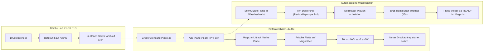

# PrintLab: Türöffner, Plattenlager, Plattenwechsler & Waschstation
## Fertigungs-, Hardware- und Software-Dokumentation (v2.1)

> [!IMPORTANT]
> **Autonome Vollausstattung für 24/7-Non-Stop-Produktion**  
> Dieses System erweitert den Bambu Lab Drucker (X1-Carbon / P1S / P1P) um eine vollautomatische Plattenlogistik. Nach jedem Druck kühlt das Bett ab, die Tür öffnet sich servogesteuert, die fertige Platte wird ins Magazin transferiert, eine frische Platte eingelegt und die benutzte Platte in der integrierten Waschstation mit Isopropanol gereinigt und getrocknet.  
> Alle 4 neuen CAD-Modelle liegen druckfertig als STL in [`werkzeuge/automation_hardware/models_stl/`](file:///C:/Users/lukas/OneDrive/Desktop/Bambuddy-Fork/werkzeuge/automation_hardware/models_stl).  
> Die interaktive 3D-Simulation mit Live-Aktionsbuttons steht unter [`printlab_3d_assembly_explosion_viewer.html`](file:///C:/Users/lukas/.gemini/antigravity/brain/e9e4f911-96ba-4410-8738-c60f903ba9db/printlab_3d_assembly_explosion_viewer.html) bereit.

---

### Inhaltsübersicht
1. [Funktionsarchitektur der 4 Subsysteme](#1-funktionsarchitektur-der-4-subsysteme)
2. [Katalog der neuen 3D-Druckteile & Slicer-Parameter](#2-katalog-der-neuen-3d-druckteile--slicer-parameter)
3. [Stückliste (Bill of Materials - BOM)](#3-stückliste-bill-of-materials---bom)
4. [Raspberry Pi GPIO Pinbelegung & Relais-Verschaltung](#4-raspberry-pi-gpio-pinbelegung--relais-verschaltung)
5. [Software-Integration & PrintLab REST-API](#5-software-integration--printlab-rest-api)
6. [Wartung, Reinigungszyklen & Betriebssicherheit](#6-wartung-reinigungszyklen--betriebssicherheit)

---

## 1. Funktionsarchitektur der 4 Subsysteme



---

## 2. Katalog der neuen 3D-Druckteile & Slicer-Parameter

Alle Teile sind konstruktiv auf verzugsfreie Beständigkeit gegen Isopropanol (IPA), Vibrationen und Baukammertemperaturen bis 60°C ausgelegt.

| Nr. | STL-Dateiname | Abmessungen | Material | Infill | Wände | Funktion |
| :--- | :--- | :--- | :--- | :--- | :--- | :--- |
| **7** | [`bambu_door_opener_servo_bracket.stl`](file:///C:/Users/lukas/OneDrive/Desktop/Bambuddy-Fork/werkzeuge/automation_hardware/models_stl/bambu_door_opener_servo_bracket.stl) | 40 × 30 × 26 mm | **ASA / PETG** | 35% Gyroid | 4 Wände | Servohalterung für MG90S am oberen Rahmen-Scharnier |
| **8** | [`bambu_door_push_pull_linkage.stl`](file:///C:/Users/lukas/OneDrive/Desktop/Bambuddy-Fork/werkzeuge/automation_hardware/models_stl/bambu_door_push_pull_linkage.stl) | 96 × 16 × 7 mm | **ASA / PETG** | 100% Solid | 5 Wände | 85mm Kniehebelstange mit Messingbuchsen-Aufnahme |
| **9** | [`plate_magazine_rack_tower.stl`](file:///C:/Users/lukas/OneDrive/Desktop/Bambuddy-Fork/werkzeuge/automation_hardware/models_stl/plate_magazine_rack_tower.stl) | 120 × 80 × 140 mm | **PETG** | 30% Gyroid | 4 Wände | 4-Slot Magazinturm mit 45° Einführfasen für Federstahlplatten |
| **10** | [`plate_washer_station_basin.stl`](file:///C:/Users/lukas/OneDrive/Desktop/Bambuddy-Fork/werkzeuge/automation_hardware/models_stl/plate_washer_station_basin.stl) | 110 × 70 × 45 mm | **PETG (dicht)** | 40% Grid | 5 Wände | Dichte IPA-Wanne mit Walzenlagerböcken und Ablaufstutzen |

---

## 3. Stückliste (Bill of Materials - BOM)

### Mechanik, Antrieb & Befestigung
* **1× TowerPro MG90S Micro-Servo:** Metallgetriebe, Stellmoment 2.2 kg·cm bei 4.8V für Türöffnung.
* **2× NEMA 17 Schrittmotoren (17HS4401):** Für Wechsler-Hubachse (Z) und Auszugsschlitten (X).
* **2× A4988 / TMC2209 Schrittmotortreiber:** Stepper-Control an GPIO.
* **1× 12V DC Mini-Peristaltikpumpe:** Selbstansaugend, chemikalienfest (Silikonschlauch) für IPA-Dosierung.
* **1× 12V Mini-Getriebemotor (60 RPM):** Für doppelten Mikrofaser-Walzenantrieb.
* **1× 12V 5015 Radialgebläse:** 4.8 CFM Luftstrom zur Schnellverdampfung von Rest-IPA.
* **1× 4-Kanal 5V Relaismodul mit Optokopplern:** Für Pumpe, Walzen und Gebläse.
* **4× TCST2103 Gabellichtschranken / Mikroschalter:** Fachbelegungserkennung im Magazin.
* **Schrauben:**
  * 6× M3 × 12 mm Zylinderkopf (Servohalter & Hebel)
  * 4× M4 × 16 mm Zylinderkopf (Magazin an Profil)
  * 8× M3 Ruthex Messing-Gewindeeinsätze

---

## 4. Raspberry Pi GPIO Pinbelegung & Relais-Verschaltung

Die Hardware wird über den PrintLab GPIO-Daemon [`werkzeuge/gpio_mechanik.py`](file:///C:/Users/lukas/OneDrive/Desktop/Bambuddy-Fork/werkzeuge/gpio_mechanik.py) angesteuert:

```
Raspberry Pi 4 / 5 GPIO Header (BCM)
┌───────────────────────────┬──────────────┬───────────────────────────────┐
│ Funktion                  │ BCM GPIO     │ Phys. Pin auf 40-Pin Header   │
├───────────────────────────┼──────────────┼───────────────────────────────┤
│ Tür-Servo (MG90S PWM)     │ GPIO 18      │ Pin 12 (PWM0)                 │
│ Tür-Endschalter OFFEN     │ GPIO 23      │ Pin 16 (Pull-Up)              │
│ Tür-Endschalter ZU        │ GPIO 24      │ Pin 18 (Pull-Up)              │
│ Platten-Bett-Sensor       │ GPIO 25      │ Pin 22 (Pull-Up)              │
│ Wechsler Motor X (Step)   │ GPIO 17      │ Pin 11                        │
│ Wechsler Motor X (Dir)    │ GPIO 27      │ Pin 13                        │
│ Wechsler Motor Z (Step)   │ GPIO 22      │ Pin 15                        │
│ Wechsler Motor Z (Dir)    │ GPIO 10      │ Pin 19                        │
│ Motoren Enable            │ GPIO 9       │ Pin 21 (Active LOW)           │
│ Waschstation IPA-Pumpe    │ GPIO 26      │ Pin 37 (Relais Kanal 1)       │
│ Waschstation Walzenmotor  │ GPIO 19      │ Pin 35 (Relais Kanal 2)       │
│ Waschstation Lüfter 5015  │ GPIO 13      │ Pin 33 (Relais Kanal 3)       │
│ HX711 Waage Daten (DT)    │ GPIO 5       │ Pin 29                        │
│ HX711 Waage Takt (SCK)    │ GPIO 6       │ Pin 31                        │
│ Masse (GND)               │ GND          │ Pin 6, 9, 14, 20, 30          │
│ 5V Versorgung             │ +5V          │ Pin 2, 4                      │
│ 3.3V Sensor-VCC           │ +3.3V        │ Pin 1                         │
└───────────────────────────┴──────────────┴───────────────────────────────┘
```

---

## 5. Software-Integration & PrintLab REST-API

Der Dienst [`backend/app/services/plate_station_service.py`](file:///C:/Users/lukas/OneDrive/Desktop/Bambuddy-Fork/backend/app/services/plate_station_service.py) und der Router [`backend/app/api/routes/plate_station_route.py`](file:///C:/Users/lukas/OneDrive/Desktop/Bambuddy-Fork/backend/app/api/routes/plate_station_route.py) bieten folgende Schnittstellen:

### 1. Systemstatus abrufen
```http
GET /api/v1/fleet/plate-station/status
```
**Antwort:**
```json
{
  "door": { "state": "closed", "angle_deg": 0.0, "is_open": false },
  "magazine": {
    "total_slots": 5,
    "ready_count": 3,
    "dirty_count": 0,
    "empty_count": 2,
    "slots": [
      { "slot_id": 1, "label": "Fach 1 - Gold PEI", "plate_type": "textured_pei", "status": "ready", "wash_cycles": 12 },
      { "slot_id": 2, "label": "Fach 2 - Smooth PEI", "plate_type": "smooth_pei", "status": "ready", "wash_cycles": 8 }
    ]
  },
  "station": { "is_swapping": false, "is_washing": false, "ipa_level_pct": 85.0 }
}
```

### 2. Tür servogesteuert öffnen / schließen
```http
POST /api/v1/fleet/plate-station/door/open
POST /api/v1/fleet/plate-station/door/close
```

### 3. Autonomen Plattenwechsel auslösen
```http
POST /api/v1/fleet/plate-station/swap
Content-Type: application/json

{ "desired_plate_type": "textured_pei" }
```

### 4. Platten-Waschgang starten
```http
POST /api/v1/fleet/plate-station/wash
Content-Type: application/json

{ "slot_id": 4 }
```

---

## 6. Wartung, Reinigungszyklen & Betriebssicherheit

* **Isopropanol (IPA $\ge 99\%$):** Alle 40 Waschzyklen den Vorratsbehälter (500 ml) auffüllen. Ein Sensor im Vorratsbehälter warnt bei $< 10\%$.
* **Mikrofaserwalzen-Pflege:** Alle 100 Zyklen kurz herausnehmen und unter warmem Wasser ausspülen.
* **Scharnier- & Kniehebel-Justierung:** Das Servo mit der Sanftanlauf-Funktion fährt in 2°-Schritten, sodass die Glastür ohne Erschütterungen schwingt.
* **Kollisions-Not-Halt:** Wird ein Endschalter nicht innerhalb des 8-Sekunden-Zeitfensters erreicht, schalten alle Schrittmotoren sofort stromlos (`STOP:OK`).
