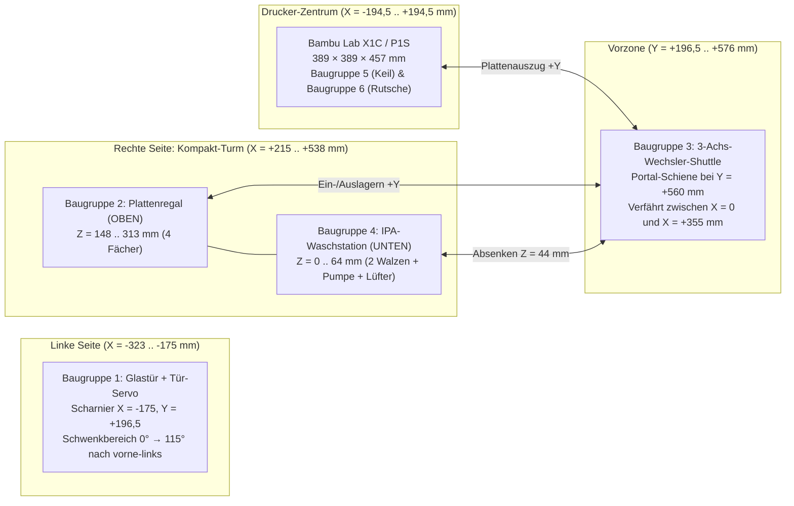

# PrintLab – Konstruktions- & Maßplan (Baugruppen 1 bis 6)
## Punkt-für-Punkt-Auslegung: Türöffner (links), Kompakt-Turm rechts (Plattenregal + Waschstation), 3-Achs-Shuttle & Bauteilabschub

> [!IMPORTANT]
> **Festgelegter Grundaufbau (Stand v2.2 – ohne Baugruppen 7 & 8):**
> * **Ursprung $(0, 0, 0)$:** Bodenmitte des Bambu Lab X1C / P1S Gehäuses ($+X$ = rechts, $+Y$ = vorne zur Glastür, $+Z$ = nach oben).
> * **Glastür (Scharnier links):** Angeschlagen bei $X = -175\text{ mm}, Y = +196{,}5\text{ mm}$; öffnet um $115^\circ$ nach **vorne-links**.
> * **Kompakt-Turm (rechts neben dem Drucker bei $X = +355\text{ mm}, Y = 0\text{ mm}$):**
>   * **Oben ($Z = 148\dots 313\text{ mm}$):** 4-Fach-Plattenregal (`Baugruppe 2`) für $257 \times 257\text{ mm}$ Federstahlplatten.
>   * **Unten ($Z = 0\dots 64\text{ mm}$):** Integrierte IPA-Waschstation (`Baugruppe 4`) direkt unter dem Plattenregal.
> * **3-Achs-Wechsler-Shuttle (`Baugruppe 3`):** Frontportal bei $Y = +560\text{ mm}$ (außerhalb des $350\text{ mm}$ Tür-Schwenkradius).
> * **Bauteil-Abschub (`Baugruppen 5 & 6`):** $35^\circ$-Räumkeil am Werkzeugkopf + mitfahrende Rutsche & Auffangschale an der Vorderkante des Heizbetts.

---

## 1. Gesamt-Koordinatensystem & Aufstellmaße

| Systemgröße | Maß / Koordinate | Technische Begründung |
| :--- | :--- | :--- |
| **Gesamt-Aufstellfläche $(B \times T \times H)$** | $928 \times 775 \times 500\text{ mm}$ | $X \in [-390, +538]\text{ mm}$, $Y \in [-194{,}5, +580]\text{ mm}$, $Z \in [0, 500]\text{ mm}$ |
| **Drucker-Außenkorpus (X1C / P1S)** | $389 \times 389 \times 457\text{ mm}$ | $X \in [-194{,}5, +194{,}5]\text{ mm}$, $Y \in [-194{,}5, +194{,}5]\text{ mm}$, $Z \in [0, 457]\text{ mm}$ |
| **Federstahl-Bauplatte (Standard Bambu)** | $257 \times 257 \times 0{,}5\text{ mm}$ | Bedruckbare Fläche $256 \times 256\text{ mm}$ + vordere Grifflasche |
| **Tür-Schwenkradius (links angeschlagen)** | $R = 350\text{ mm}$ um $(-175, +196{,}5)$ | Maximale vordere Ausladung bei $90^\circ$: $Y_{\max} = 196{,}5 + 350 = 546{,}5\text{ mm}$ |
| **Sicherheitsabstand Shuttle-Schiene** | $Y_{\text{Rail}} = +560\text{ mm}$ | Liegt $13{,}5\text{ mm}$ vor dem maximalen Tür-Schwenkbogen ($546{,}5\text{ mm}$) |
| **Seitlicher Abstand Drucker ↔ Kompakt-Turm** | $20{,}5\text{ mm}$ ($X = +194{,}5 \to +215\text{ mm}$) | Entkoppelt Druckervibrationen vom Plattenregal |

---

## 2. Punkt-für-Punkt-Planung der 6 Baugruppen

### Baugruppe 1: Automatischer Türöffner (Scharnier links)
* **Einbauposition:** Oben links auf dem vorderen Rahmenprofil direkt über der originalen Tür-Drehachse ($X = -185\dots -135\text{ mm}$, $Y = +162\dots +202\text{ mm}$, $Z = 457\dots 483\text{ mm}$).
* **Einzelteile & exakte Maße:**
  1. **Servo-Halterblock (`bambu_door_opener_servo_bracket.stl`):**
     * Außenmaße: $50 \times 40 \times 26\text{ mm}$ (Wandstärke $4{,}0\text{ mm}$, Material **ASA** oder **PETG**, $4\text{ Wände}$, $35\,\%$ Gyroid-Infill).
     * Servotasche: $23{,}2 \times 12{,}6 \times 18{,}0\text{ mm}$ (Passung $+0{,}2\text{ mm}$ für Metallgetriebe-Servo **MG90S**).
     * Flanschbohrungen: $2 \times \varnothing 3{,}2\text{ mm}$ im Abstand $38\text{ mm}$ zur Verschraubung am oberen linken Eckpfosten.
  2. **Servohorn (Antriebshebel):**
     * Wirksame Hebellänge: $L_1 = 28\text{ mm}$ (Aluminium-Servoarm 25T auf MG90S-Abtriebswelle bei $X = -150\text{ mm}, Y = +200\text{ mm}, Z = 487\text{ mm}$).
  3. **Kniehebel-Schubstange (`bambu_door_push_pull_linkage.stl`):**
     * Länge von Auge zu Auge: $L_2 = 85{,}0\text{ mm}$, Querschnitt $8{,}0 \times 5{,}0\text{ mm}$, beidseitig $\varnothing 3{,}05\text{ mm}$ Bohrung für M3-Kugelköpfe / Gelenkschrauben.
     * Tür-Anlenkpunkt: $70{,}0\text{ mm}$ vom linken Scharnier entlang der Türoberkante ($Z = 437\text{ mm}$) mit 3M-VHB-Acrylklebeband + Klemmclip an der Glastür fixiert.
* **Kinematik & Ansteuerung:**
  * Geschlossen ($0^\circ$): Pulsweite $1000\text{ µs}$ (hält die Tür gegen die Magnetdichtung geschlossen).
  * Offen ($115^\circ$ nach vorne-links): Pulsweite $2150\text{ µs}$, sanfte S-Kurven-Rampe über $1{,}8\text{ s}$ ($2^\circ\text{ pro }30\text{ ms}$), damit das Glas nicht schlägt.

---

### Baugruppe 2: Plattenregal (4-Fach-Magazin im Kompakt-Turm oben)
* **Einbauposition:** Rechts neben dem Drucker im Obergeschoss des Kompakt-Turms ($X = +215\dots +495\text{ mm}$, Plattenmitte $X = +355\text{ mm}$, $Y = -145\dots +145\text{ mm}$, $Z = 148\dots 313\text{ mm}$).
* **Tragrahmen (Kompakt-Turm-Grundgestell für Baugruppe 2 + 4):**
  * **4× Vertikal-Steher:** Aluminiumprofil **2020 I-Typ Nut 5**, Länge jeweils **$313\text{ mm}$** an den Ecken $(+215, -145)$, $(+215, +135)$, $(+485, -145)$, $(+485, +135)$.
  * **Zwischenboden (Trennebene zwischen Waschstation unten und Plattenregal oben):** $280 \times 290 \times 8\text{ mm}$ auf Höhe $Z = 148\dots 156\text{ mm}$ (schützt die trockenen Platten im Regal vor IPA-Dämpfen aus der Waschstation).
  * **Deckelplatte:** $280 \times 290 \times 8\text{ mm}$ auf Höhe $Z = 305\dots 313\text{ mm}$.
* **Fächer-Geometrie (`plate_magazine_rack_tower.stl`):**
  * **Lichte Innenbreite zwischen den Seitenwänden:** $266{,}0\text{ mm}$ (ergibt $4{,}5\text{ mm}$ seitliches Spiel pro Seite zur Einführung der $257\text{ mm}$ breiten Platte über $45^\circ$-Zentrierschrägen auf $258{,}5\text{ mm}$ Führungsmaß).
  * **Auflageleisten links & rechts:** $16\text{ mm}$ breit ($8\text{ mm}$ Plattenauflage je Seite), $4{,}0\text{ mm}$ stark, Länge $270\text{ mm}$ ($Y = -135\dots +135\text{ mm}$), vorne ($+Y$) mit $45^\circ \times 6\text{ mm}$ Einlauftrichter.
  * **Exakte Slot-Höhen (Plattenoberkante $Z$):**
    * **Fach 1:** $Z_1 = 180{,}0\text{ mm}$ (Auflageleiste Oberkante bei $Z = 178{,}5\text{ mm}$)
    * **Fach 2:** $Z_2 = 215{,}0\text{ mm}$ (Rastermaß $\Delta Z = 35{,}0\text{ mm}$)
    * **Fach 3:** $Z_3 = 250{,}0\text{ mm}$ (Rastermaß $\Delta Z = 35{,}0\text{ mm}$)
    * **Fach 4:** $Z_4 = 285{,}0\text{ mm}$ (Rastermaß $\Delta Z = 35{,}0\text{ mm}$)
  * **Belegungssensorik:** Pro Fach 1× optische Gabellichtschranke **TCST2103** an der hinteren Anschlagschiene ($Y = -128{,}5\text{ mm}$), erkennt automatisch, ob eine Platte vollständig eingeschoben ist.

---

### Baugruppe 3: 3-Achs-Plattenwechsler-Shuttle (X/Y/Z-Portal)
* **Einbauposition:** Vor dem Drucker und dem rechten Kompakt-Turm bei $Y_{\text{Rail}} = +560\text{ mm}$ ($X = -160\dots +520\text{ mm}$, $Z = 0\dots 330\text{ mm}$).
* **Achsen-Auslegung & Maße:**
  1. **X-Achse (Horizontaler Querträger zwischen Drucker $X = 0$ und Kompakt-Turm $X = +355\text{ mm}$):**
     * **2× Vertikalpfosten:** Alu-Profil **2020**, Länge **$330\text{ mm}$**, montiert bei $X_{\text{links}} = -152\text{ mm}, Y = +560\text{ mm}$ und $X_{\text{rechts}} = +512\text{ mm}, Y = +560\text{ mm}$.
     * **X-Querträger (fährt auf Z mit):** Alu-Profil **2020**, Länge **$680\text{ mm}$** ($X = -160\dots +520\text{ mm}$) + Linearschiene **MGN12H ($600\text{ mm}$)**.
     * **Verfahrweg (Netto-Hub X):** $\Delta X = 355{,}0\text{ mm}$ ($X = 0{,}0\text{ mm}$ Druckermitte $\leftrightarrow X = +355{,}0\text{ mm}$ Kompakt-Turm-Mitte).
     * **Antrieb X:** NEMA17 Schrittmotor ($1{,}8^\circ$, $42 \times 42 \times 40\text{ mm}$) + GT2-Zahnriemen ($6\text{ mm}$ breit, Länge $1450\text{ mm}$) + 20T-Riemenscheibe ($40\text{ mm/U}$).
  2. **Z-Achse (Vertikaler Hub für Bett, 4 Regalfächer & Waschstation):**
     * **Führung & Antrieb:** 2× Linearschiene **MGN12H ($300\text{ mm}$)** an den beiden äußeren Stehern + 1× Trapezgewindespindel **T8×8 (Steigung $8\text{ mm}$, Länge $300\text{ mm}$)** mit Anti-Backlash-Messingmutter und NEMA17-Motor.
     * **Anfahrpositionen Z:**
       * Waschstation-Walzenhöhe: $Z_{\text{Wash}} = 44{,}0\text{ mm}$
       * Regalfächer 1–4: $Z = 180{,}0 / 215{,}0 / 250{,}0 / 285{,}0\text{ mm}$
       * Drucker-Übergabehöhe: $Z_{\text{Swap}} = 215{,}0\text{ mm}$
  3. **Y-Achse (Teleskop-Greiferarm durch die offene Fronttür):**
     * **Führung:** Leichtbau-Linearschiene **MGN9H ($420\text{ mm}$)** auf dem X-Schlitten, angetrieben über Zahnstange Modul 1.0 (oder GT2-Riemen) mit NEMA17-Pancake-Motor ($42 \times 42 \times 23\text{ mm}$).
     * **Verfahrweg Y (Greifspitze `gy`):**
       * Parkposition: $Y_{\text{Park}} = +525\text{ mm}$ (komplett hinter der Tür-Schwenklinie geparkt).
       * Vorzone (Transferkorridor zwischen Drucker und Turm): Plattenmitte bei $Y_{\text{Transfer}} = +345{,}0\text{ mm}$ (Hinterkante der $257\text{ mm}$ Platte liegt bei $Y = +216{,}5\text{ mm}$, also $20\text{ mm}$ frei vor der Druckerfront $Y = +196{,}5\text{ mm}$).
       * Greifposition am Heizbett / im Regalfach / in der Waschstation: Plattenmitte bei $Y = 0{,}0\text{ mm}$ $\Rightarrow$ Plattenvorderkante bei $Y = +128{,}5\text{ mm}$, Greiferbacke bei $Y_{\text{Grip}} = +134{,}5\text{ mm}$ (**Netto-Teleskophub $\Delta Y = 390{,}5\text{ mm}$**).
     * **Plattengreifer (`60 × 12 × 11 mm`):** Gabelmaul mit **12V-Haftmagnet ($80\text{ N}$)** + mechanischer Unterlippe ($3{,}5\text{ mm}$ Einschubtiefe unter die vordere Grifflasche der Federstahlplatte). Zum Abziehen vom Magnetbett fährt das Bett erst $2\text{ mm}$ nach unten, sodass sich die Vorderkante sauber vom Heizbett löst.

---

### Baugruppe 4: IPA-Platten-Waschstation (im Kompakt-Turm unten)
* **Einbauposition:** Im Untergeschoss des rechten Kompakt-Turms direkt unter dem Plattenregal ($X = +225\dots +485\text{ mm}$, Mitte $X = +355\text{ mm}$, $Y = -140\dots +140\text{ mm}$, $Z = 0\dots 64\text{ mm}$).
* **Einzelteile & exakte Maße (`plate_washer_station_basin.stl`):**
  1. **Chemikalienbeständige Waschwanne (PETG / PP, 100 % wasserdicht mit 5 Wänden):**
     * Außenmaß Wanne: $260\text{ mm}$ (Breite $X$) $\times 280\text{ mm}$ (Tiefe $Y$) $\times 64\text{ mm}$ (Höhe $Z$).
     * Wandstärke: $6{,}0\text{ mm}$ an den Seiten/hinten ($Z = 5\dots 64\text{ mm}$), Bodenstärke $5{,}0\text{ mm}$ mit $3^\circ$ Gefälle zur Ablassöffnung.
     * Vordere Einlauflippe ($Y = +134\dots +140\text{ mm}$): Abgesenkt auf **$Z = 32{,}0\text{ mm}$**, damit das Shuttle die Platte auf Höhe **$Z_{\text{Wash}} = 44{,}0\text{ mm}$** horizontal von vorne ($+Y$) über die Lippe direkt auf die Walzen schieben kann.
  2. **2× Gegenläufige Mikrofaser-Schrubbwalzen:**
     * Position: Walze 1 bei $Y = -45{,}0\text{ mm}$, Walze 2 bei $Y = +45{,}0\text{ mm}$ (Abstand $90{,}0\text{ mm}$), Wellenachse auf **$Z = 32{,}0\text{ mm}$**.
     * Walzenmaß: Außendurchmesser $\varnothing 24{,}0\text{ mm}$ (Oberkante bei $Z = 44{,}0\text{ mm}$ = Plattenunterseite!), Länge $246\text{ mm}$ ($X = +232\dots +478\text{ mm}$) auf $\varnothing 8\text{ mm}$ Edelstahlwelle.
     * Lagerung & Antrieb: $4 \times$ Rillenkugellager **608ZZ ($8 \times 22 \times 7\text{ mm}$)** in gedruckten Lagersitzen + **12V N20-Getriebemotor ($150\text{ U/min}$)** über O-Ring-Riemen (Relais an **GPIO 26**).
  3. **IPA-Sprühsystem & Trocknungsgebläse (Rechte Außenseite $X = +498\dots +538\text{ mm}$):**
     * **Peristaltikpumpe (12V DC, Silikonschlauch $3 \times 5\text{ mm}$):** Gehäuse $40 \times 60 \times 48\text{ mm}$ bei $X = +498\dots +538\text{ mm}, Y = -65\dots -5\text{ mm}$ (Relais an **GPIO 19**). Fördert $99{,}9\,\%$ Isopropanol aus der $250\text{ ml}$ Vorratsflasche ($\varnothing 55 \times 120\text{ mm}$) in das obere Sprührohr ($\varnothing 6\text{ mm}$ Messingrohr mit $5 \times \varnothing 0{,}6\text{ mm}$ Düsenbohrungen über Walze 1).
     * **Radiallüfter 5015 (12V DC, $50 \times 50 \times 15\text{ mm}$):** Mit Luftleitdüse ($40 \times 65 \times 54\text{ mm}$) bei $X = +498\dots +538\text{ mm}, Y = +65\dots +130\text{ mm}, Z = 12\dots 66\text{ mm}$ (Relais an **GPIO 13**); bläst im $30^\circ$-Winkel über die Plattenoberfläche zur rückstandsfreien Verdunstung.

---

### Baugruppe 5: Werkzeugkopf-Abschubkeil (Toolhead Sweeper Blade)
* **Einbauposition:** Untere Vorderseite des CoreXY-Werkzeugkopfs ($X_{\text{Head}} \pm 37{,}5\text{ mm}$, $Y = Y_{\text{Head}} + 25\dots +37\text{ mm}$, $Z = 339{,}5\dots 352{,}0\text{ mm}$).
* **Exakte Bauteilmaße (`bambu_toolhead_sweeper_blade.stl`):**
  * **Breite ($X$):** $75{,}0\text{ mm}$ (verteilt die Schubkraft großflächig auf das Druckteil).
  * **Tiefe ($Y$):** $30{,}0\text{ mm}$ (davon $18\text{ mm}$ Montageflansch unter dem Werkzeugkopf + $12\text{ mm}$ vorderer Räumkeil).
  * **Höhe ($Z$):** $12{,}5\text{ mm}$ mit **$35^\circ$ Keilwinkel** (erzeugt beim Vorwärtsschub $+Y$ einen nach vorn-oben gerichteten Kraftvektor zum Ablösen vom PEI-Federstahl).
  * **Kritischer Düsen-Freigang ($\Delta Z_{\text{Nozzle}}$):**
    * Düsenspitze liegt bei $Z_{\text{Nozzle}} = 338{,}0\text{ mm}$.
    * Keil-Unterkante liegt exakt bei $Z_{\text{Blade}} = 339{,}5\text{ mm}$ (**$+1{,}5\text{ mm}$ höher als die Düsenspitze** $\Rightarrow$ berührt während des normalen Schichtdrucks niemals das Bauteil!).
    * Zum Abschieben fährt das Heizbett auf **$Z_{\text{Push}} = 336{,}5\text{ mm}$** (sodass die Keil-Unterkante exakt $3{,}0\text{ mm}$ über der Druckplatte angreift) und der Werkzeugkopf fährt mit $F = 3600\text{ mm/min}$ von $Y = -150\text{ mm}$ nach $Y = +135\text{ mm}$.
  * **Befestigung:** $2 \times \text{M3}\times 12\text{ mm}$ Zylinderschrauben in $2 \times \text{Ruthex M3}$-Einschmelzgewinden (Lochabstand $40{,}0\text{ mm}$, Material **ASA** wegen Bauraumtemperatur bis $60\,^\circ\text{C}$).

---

### Baugruppe 6: Mitfahrende Auswurfrutsche & Auffangschale am Heizbett
* **Einbauposition:** Direkt an der vorderen Kante des Heizbett-Trägers eingeklickt ($X = -62\dots +62\text{ mm}$, $Y = +128{,}5\dots +186{,}0\text{ mm}$, fährt in $Z$ mit dem Heizbett mit!).
* **Warum mitfahrend unter der Plattenebene?**
  * Zwischen der Vorderkante der $257\text{ mm}$ Druckplatte ($Y = +128{,}5\text{ mm}$) und der geschlossenen Glastür ($Y = +196{,}5\text{ mm}$) liegen exakt **$68{,}0\text{ mm}$ Freiraum**.
  * Da die Rutsche und die Auffangschale **komplett unterhalb der Plattenoberkante** bleiben ($Z_{\text{Oberkante}} = Z_{\text{Bett}} - 2{,}5\text{ mm}$), kann das Wechsler-Shuttle die Federstahlplatte bei offener Tür ungehindert horizontal ($+Y$) über die Rutsche und Schale hinweg herausziehen!
* **Exakte Bauteilmaße (`bambu_bed_ejection_chute.stl`):**
  1. **32°-Abgleitrampe (Rutsche):**
     * Breite $120{,}0\text{ mm}$ ($X = -60\dots +60\text{ mm}$), horizontale Länge $38{,}0\text{ mm}$ ($Y = +128{,}5\dots +166{,}5\text{ mm}$), Höhenabfall $\Delta Z = -24{,}0\text{ mm}$, Blech-/Wandstärke $2{,}5\text{ mm}$.
  2. **Integrierte Auffangschale:**
     * Außenmaß: $124{,}0\text{ mm}$ ($X = -62\dots +62\text{ mm}$) $\times 51{,}0\text{ mm}$ ($Y = +135\dots +186\text{ mm}$) $\times 46{,}0\text{ mm}$ Tiefe ($Z = Z_{\text{Bett}} - 60\dots Z_{\text{Bett}} - 14\text{ mm}$).
     * Seiten- und Vorderwandstärke: $4{,}0\text{ mm}$, Bodenstärke $3{,}0\text{ mm}$ (mit $10\text{ mm}$ verbleibendem Sicherheitsabstand zur geschlossenen Glastür bei $Y = +196{,}5\text{ mm}$!).

---

## 3. Vollständige Zuschnitt- & Stückliste (BOM für Baugruppen 1–6)

### A. 3D-Druckteile (Eigenfertigung aus `werkzeuge/automation_hardware/models_stl/`)

| Nr. | Baugruppe | STL-Datei | Außenmaße $(B \times T \times H)$ | Material | Wände / Infill |
| :---: | :--- | :--- | :--- | :---: | :---: |
| **1a** | 1 · Türöffner | [`bambu_door_opener_servo_bracket.stl`](file:///C:/Users/lukas/OneDrive/Desktop/Bambuddy-Fork/werkzeuge/automation_hardware/models_stl/bambu_door_opener_servo_bracket.stl) | $50 \times 40 \times 26\text{ mm}$ | ASA / PETG | 4 Wände · 35 % Gyroid |
| **1b** | 1 · Türöffner | [`bambu_door_push_pull_linkage.stl`](file:///C:/Users/lukas/OneDrive/Desktop/Bambuddy-Fork/werkzeuge/automation_hardware/models_stl/bambu_door_push_pull_linkage.stl) | $85 \times 8 \times 5\text{ mm}$ | ASA / PETG | 5 Wände · 50 % Linien |
| **2** | 2 · Plattenregal | [`plate_magazine_rack_tower.stl`](file:///C:/Users/lukas/OneDrive/Desktop/Bambuddy-Fork/werkzeuge/automation_hardware/models_stl/plate_magazine_rack_tower.stl) | $280 \times 290 \times 165\text{ mm}$ | PETG | 4 Wände · 30 % Gyroid |
| **4** | 4 · Waschstation | [`plate_washer_station_basin.stl`](file:///C:/Users/lukas/OneDrive/Desktop/Bambuddy-Fork/werkzeuge/automation_hardware/models_stl/plate_washer_station_basin.stl) | $260 \times 280 \times 64\text{ mm}$ | PETG / PP | 5 Wände · 35 % (dicht) |
| **5** | 5 · Abschubkeil | [`bambu_toolhead_sweeper_blade.stl`](file:///C:/Users/lukas/OneDrive/Desktop/Bambuddy-Fork/werkzeuge/automation_hardware/models_stl/bambu_toolhead_sweeper_blade.stl) | $75 \times 30 \times 12{,}5\text{ mm}$ | ASA | 4 Wände · 35 % Gyroid |
| **6** | 6 · Rutsche & Schale | [`bambu_bed_ejection_chute.stl`](file:///C:/Users/lukas/OneDrive/Desktop/Bambuddy-Fork/werkzeuge/automation_hardware/models_stl/bambu_bed_ejection_chute.stl) | $124 \times 58 \times 60\text{ mm}$ | PETG | 3 Wände · 25 % Gyroid |

### B. Aluminium-Profile, Lineartechnik & Mechanik (Zuschnittliste)

| Pos. | Bauteil / Halbzeug | Exakte Spezifikation & Zuschnittmaß | Menge | Verwendung |
| :---: | :--- | :--- | :---: | :--- |
| **M1** | Alu-Profil 2020 Nut 5 | Länge **$313{,}0\text{ mm}$** (stirnseitig M5 Gewinde) | 4 Stk. | Ecksteher Kompakt-Turm (Regal + Waschstation) |
| **M2** | Alu-Profil 2020 Nut 5 | Länge **$330{,}0\text{ mm}$** | 2 Stk. | Vertikalsteher Wechsler-Shuttle ($X = -152 / +512$) |
| **M3** | Alu-Profil 2020 Nut 5 | Länge **$680{,}0\text{ mm}$** | 1 Stk. | Horizontaler X-Querträger Shuttle ($Y = +560$) |
| **M4** | Linearschiene MGN12H | Länge **$600{,}0\text{ mm}$** inkl. 1× Wagen MGN12H | 1 Satz | X-Achse Wechsler-Shuttle |
| **M5** | Linearschiene MGN12H | Länge **$300{,}0\text{ mm}$** inkl. je 1× Wagen MGN12H | 2 Sätze | Z-Achse Vertikalhub Shuttle (links & rechts) |
| **M6** | Linearschiene MGN9H | Länge **$420{,}0\text{ mm}$** inkl. 1× Wagen MGN9H | 1 Satz | Y-Teleskoparm (fährt durch die Fronttür) |
| **M7** | Trapezgewindespindel | **T8×8**, Länge **$300{,}0\text{ mm}$** + Anti-Backlash-Mutter | 1 Satz | Z-Hub-Antrieb Shuttle |
| **M8** | GT2 Zahnriemen + Pulleys | Breite $6\text{ mm}$, Länge **$2500\text{ mm}$** + $2 \times$ 20T Pulley ($\varnothing 5\text{ mm}$) | 1 Satz | Antrieb X-Achse & Y-Teleskoparm |
| **M9** | Edelstahlwellen $\varnothing 8\text{ mm}$ | Länge **$260{,}0\text{ mm}$** (Passung h6) | 2 Stk. | Walzenachsen in der IPA-Waschstation |
| **M10** | Kugellager 608ZZ | $\varnothing 8 \times \varnothing 22 \times 7\text{ mm}$ (gedichtet) | 4 Stk. | Walzenlagerung in der Waschstation |
| **M11** | Mikrofaser-Hülsen | $\varnothing_{\text{außen}} 24\text{ mm}$, $\varnothing_{\text{innen}} 8\text{ mm}$, Länge **$246\text{ mm}$** | 2 Stk. | Gegenläufige Reinigungs-Walzen |
| **M12** | Schraubensatz & Inserts | Ruthex M3 (10×), M3×10/12 (20×), M4×10 + Nutenstein (30×) | 1 Satz | Gesamtverschraubung Baugruppen 1–6 |

### C. Aktuatorik, Pumpen & Elektronik (GPIO-Zuordnung)

| Pos. | Komponente | Technische Daten | Steuerung / Raspberry Pi Pin | Funktion |
| :---: | :--- | :--- | :--- | :--- |
| **E1** | Metall-Servo **MG90S** | $4{,}8\dots 6{,}0\text{ V}$, Stellmoment $2{,}2\text{ kg}\cdot\text{cm}$ | **BCM 18 (Pin 12)** – Hardware-PWM | Türöffner links ($0^\circ \leftrightarrow 115^\circ$) |
| **E2** | 3× Schrittmotor **NEMA17** | $1{,}8^\circ$, $1{,}5\text{ A}$ + 3× Treiber **TMC2209** | UART / Step-Dir Controller | Shuttle-Achsen $X$, $Y$ (Teleskop) und $Z$ |
| **E3** | Elektromagnet-Greifer | 12V DC, $80\text{ N}$ Haltekraft ($\varnothing 25 \times 20\text{ mm}$) | Relais / MOSFET | Greift die Vorderkante der Federstahlplatte |
| **E4** | Getriebemotor **N20 12V** | $150\text{ U/min}$, hohes Drehmoment | **BCM 26 (Pin 37)** – Relais Kanal 1 | Treibt die 2 Mikrofaser-Walzen gegenläufig an |
| **E5** | **Peristaltikpumpe 12V** | $80\text{ ml/min}$, IPA-beständiger Silikonschlauch | **BCM 19 (Pin 35)** – Relais Kanal 2 | Dosiert Isopropanol ($99{,}9\,\%$) auf die Platte |
| **E6** | **Radiallüfter 5015 12V** | $50 \times 50 \times 15\text{ mm}$, $6000\text{ U/min}$ | **BCM 13 (Pin 33)** – Relais Kanal 3 | Trocknet die gewaschene Platte in $15\text{ s}$ |
| **E7** | 4× Lichtschranke **TCST2103** | Optischer Slot-Sensor $3{,}3\text{ V}$ | GPIO-Eingänge (Fächer 1–4) | Erkennt belegte/freie Fächer im Plattenregal |
| **E8** | Netzteil MeanWell **LRS-100-12** | 12V DC / $8{,}5\text{ A}$ ($100\text{ W}$) + 5V/3A Buck-Converter | Primärversorgung | Versorgt Motoren, Pumpe, Magnet, Lüfter & Servo |

---

## 4. Millimetergenaue Ablauf-Kinematik (Zyklus-Fahrplan)

1. **Bauteil-Abschub nach Druckende (`Baugruppen 1, 5 & 6`):**
   * Abkühlen des Heizbetts auf $< 35\,^\circ\text{C}$ (automatische Temperaturfreigabe).
   * **Baugruppe 1 (Tür-Servo links):** Öffnet die Glastür von $0^\circ$ auf $115^\circ$ nach vorne-links.
   * Heizbett fährt auf Abschubhöhe **$Z_{\text{Push}} = 336{,}5\text{ mm}$**; Werkzeugkopf positioniert sich mittig hinter dem Bauteil ($X = 0\text{ mm}, Y = -150\text{ mm}$).
   * **Baugruppe 5 (Abschubkeil):** Werkzeugkopf fährt nach vorne auf $Y = +135\text{ mm}$ und schiebt das Druckteil über die **Baugruppe 6 (32°-Rutsche)** in die mitfahrende Auffangschale ($Y = +135\dots +186\text{ mm}$).

2. **Automatischer Plattenwechsel (`Baugruppen 2 & 3`):**
   * Heizbett fährt auf Übergabehöhe **$Z_{\text{Swap}} = 215{,}0\text{ mm}$**.
   * **Baugruppe 3 (Shuttle):** Fährt auf $X = 0{,}0\text{ mm}, Z = 215{,}0\text{ mm}$, schiebt den Y-Teleskoparm durch die offene Tür auf $Y_{\text{Grip}} = +134{,}5\text{ mm}$, aktiviert den Greifmagneten und zieht die gebrauchte Platte gerade nach vorne auf **$Y_{\text{Transfer}} = +345{,}0\text{ mm}$**.
   * Shuttle verfährt nach **rechts** vor den Kompakt-Turm auf **$X = +355{,}0\text{ mm}$** und auf die Höhe des freien Regalfachs ($Z \in \{180, 215, 250, 285\}\text{ mm}$), schiebt die gebrauchte Platte auf $Y = 0{,}0\text{ mm}$ in **Baugruppe 2 (Plattenregal)** ein und löst den Greifer.
   * Shuttle wechselt in $Z$ auf ein Fach mit `frischer` Platte, zieht diese auf $Y = +345{,}0\text{ mm}$ heraus, verfährt nach links auf $X = 0{,}0\text{ mm}, Z = 215{,}0\text{ mm}$ und legt sie durch die Fronttür auf das Heizbett ($Y = 0{,}0\text{ mm}$).
   * Shuttle parkt bei $X = +355\text{ mm}, Y = +525\text{ mm}$; Glastür schließt ($115^\circ \to 0^\circ$); nächster Druckauftrag startet sofort.

3. **Parallele IPA-Plattenreinigung im Kompakt-Turm (`Baugruppen 2, 3 & 4`):**
   * Während der Drucker bereits den nächsten Auftrag druckt, zieht das Shuttle bei $X = +355{,}0\text{ mm}$ die verschmutzte Platte aus dem oberen Plattenregal ($Y = 0 \to +345\text{ mm}$).
   * Shuttle senkt die Platte **senkrecht entlang $Z$** auf **$Z_{\text{Wash}} = 44{,}0\text{ mm}$** ab und schiebt sie in die direkt darunterliegende **Baugruppe 4 (Waschstation)** ($Y = +345 \to 0\text{ mm}$).
   * **Reinigung ($12\text{ s}$):** Peristaltikpumpe sprüht IPA ($4\text{ s}$), die 2 Mikrofaser-Walzen rotieren gegenläufig, während das Shuttle die Platte um $\pm 26\text{ mm}$ in $Y$ oszilliert; danach trocknet das 5015-Gebläse ($6\text{ s}$) die Oberfläche streifenfrei.
   * Shuttle zieht die gereinigte Platte auf $Y = +345\text{ mm}$, hebt sie zurück auf ihre Fachhöhe $Z$ und lagert sie als **`frisch`** im Plattenregal ein.

---

## 5. Checkliste zum Einmessen am realen Drucker vor Montage

> [!TIP]
> Prüfe vor dem endgültigen Verschrauben des Kompakt-Turms kurz diese 3 Maße mit dem Messschieber an deinem Drucker:
> 1. **Freiraum Bettvorderkante ↔ Innenseite Glastür:** Sollwert $\ge 60\text{ mm}$ (Schale baut $57{,}5\text{ mm}$ vor die Bettvorderkante).
> 2. **Tisch-Höhenversatz unter dem Drucker:** Falls dein Drucker auf Gummifüßen oder einer Betonplatte steht ($\Delta Z_{\text{Fuß}}$), diesen Wert einfach zu allen $Z$-Koordinaten des Shuttles ($Z_{\text{Swap}}, Z_{\text{Wash}}$) addieren.
> 3. **Kniehebel-Befestigungspunkt an der Glastür:** Bei geschlossener Tür den Servo auf $1000\text{ µs}$ stellen und den Klebepunkt an der Türoberkante ($70\text{ mm}$ vom linken Scharnier) vor dem Festkleben einmal spannungsfrei anhalten.
